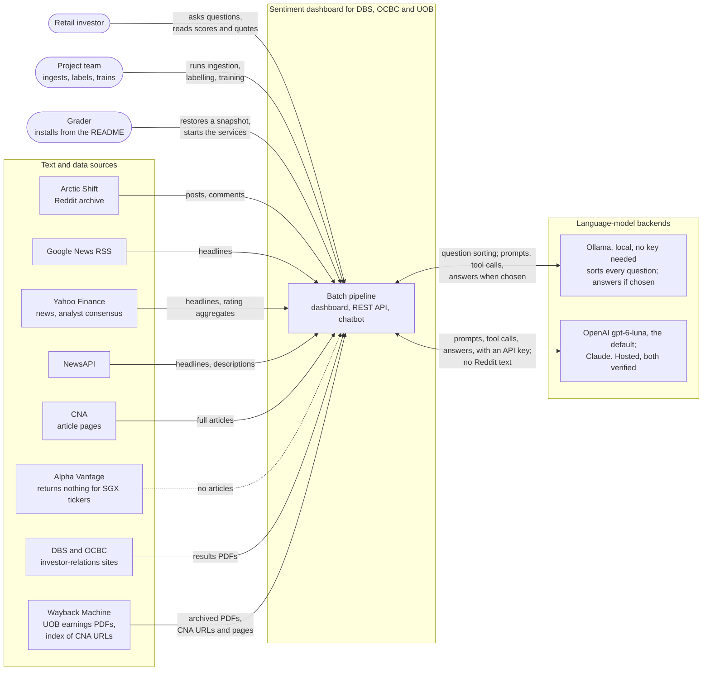

# System context

Who uses the system and which outside services it depends on. For a reader meeting the project for the first time, and for the report's introduction.

**Legend.** Solid shapes and arrows are built and running. Dashed shapes and arrows labelled *planned* are decided but not yet built, with the DESIGN.md decision that records them. Shapes marked *not installed* exist in the repository but aren't running anywhere.

Rendered for the report: [SVG](img/01-system-context.svg) · [PNG](img/01-system-context.png)

## What this shows and doesn't show

Shows every external party the code talks to and what crosses each boundary. It
doesn't show internals (see [02](02-runtime.md) and [04](04-pipeline.md)) or the CNA
feed, which has a scraper (`ingest/cna_scraper.py`) that writes a JSON file and is not
connected to the system. Alpha Vantage is drawn dashed because its adapter runs but no
SGX ticker is indexed, so it contributes nothing. The chatbot answers through OpenAI's
`gpt-6-luna` by default; Claude is the other hosted option, and both have returned real
responses. The local Ollama model answers when chosen (`CHATBOT_BACKEND=ollama`, no key
needed) and sorts every question by intent whichever model answers. A hosted model never
receives Reddit text; CNA and broker-research text, which stays out of git and
shared folders, may be sent to it, as the team agreed. The OpenAI backend also reaches any
OpenAI-compatible provider, such as Groq, through `OPENAI_BASE_URL`.

## Sources

Each row names the file and line an element comes from, and the text that line must contain; `check_sources.py` verifies them.

| element | source | symbol checked |
|---|---|---|
| Arctic Shift | `ingest/arctic_shift.py:40` | `BASE_URL = "https://arctic-shift` |
| Google News RSS | `ingest/google_news.py:55` | `RSS_URL = "https://news.google.com` |
| Yahoo Finance news | `ingest/yahoo_news.py:93` | `yf.Ticker(ticker).get_news(` |
| Yahoo Finance consensus | `ingest/yahoo_analyst.py:71` | `finance/quoteSummary/` |
| NewsAPI | `ingest/newsapi.py:20` | `newsapi.org/v2/everything` |
| CNA article pages | `ingest/cna_archive.py:69` | `SITE = "www.channelnewsasia.com"` |
| Wayback index of CNA URLs | `ingest/cna_archive.py:68` | `CDX_URL = "https://web.archive.org/cdx/search/cdx"` |
| archived CNA pages | `ingest/cna_archive.py:214` | `archived = f"https://web.archive.org/web/` |
| Alpha Vantage | `ingest/alphavantage.py:50` | `alphavantage.co/query` |
| Alpha Vantage returns nothing | `ingest/alphavantage.py:48` | `doesn't index SGX-listed names` |
| DBS investor relations | `ingest/earnings_fetch_ir.py:64` | `https://www.dbs.com/investors` |
| OCBC investor relations | `ingest/earnings_fetch_ir.py:70` | `https://www.ocbc.com/group/investors` |
| Wayback Machine | `ingest/earnings_fetch_uob.py:49` | `CDX_URL = "http://web.archive.org` |
| Ollama | `config/chatbot.yaml:7` | `ollama_url:       {value: "http://localhost:11434"` |
| Claude | `chatbot/backends/claude_backend.py:41` | `import anthropic` |
| OpenAI, or any compatible provider via `OPENAI_BASE_URL` | `config/chatbot.yaml:8` | `openai_base_url:  {value: "https://api.openai.com/v1", env: OPENAI_BASE_URL}` |
| OpenAI verified | `chatbot/backends/openai_backend.py:7` | `Verified against the live API on 2026-10-24 with gpt-6-luna` |
| OpenAI is the default | `config/chatbot.yaml:5` | `backend:          {value: "openai", env: CHATBOT_BACKEND}` |
| OpenAI's model | `config/chatbot.yaml:18` | `openai:  {value: "gpt-6-luna", env: OPENAI_MODEL}` |
| the local model sorts every question | `config/chatbot.yaml:19` | `intent:  {value: "llama3.1:8b", env: CHATBOT_INTENT_MODEL}` |
| CNA and broker research cleared for a hosted model | `config/sources.yaml:29` | `team_only: true,  hosted_model: true` |
| a hosted model never sees Reddit text | `chatbot/backends/base.py:99` | `def withhold_reddit(name: str, content):` |
| Ollama when `auto` finds no key | `chatbot/backends/__init__.py:30` | `return "ollama"` |
| CNA scraper writes JSON, not the database | `ingest/cna_scraper.py:21` | `import json` |
