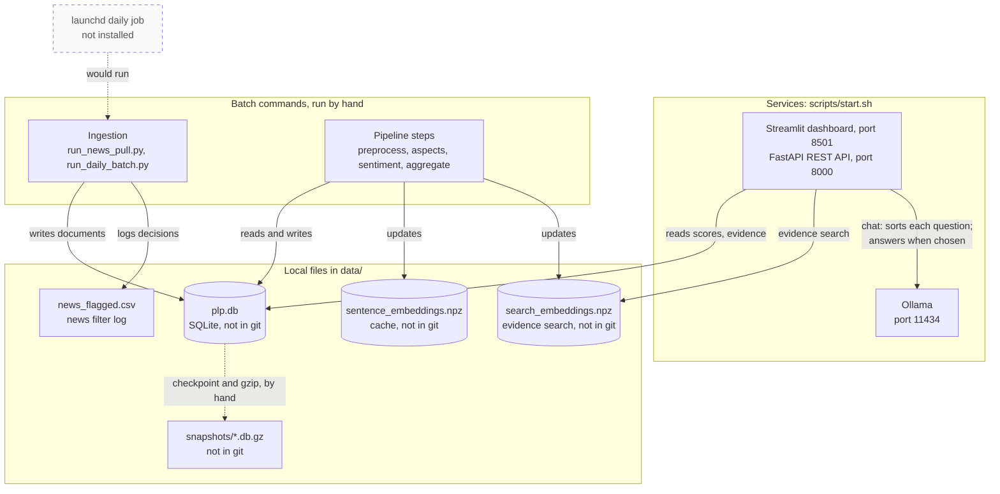

# Runtime: what runs where

Which processes run on one machine, their ports, and which files each reads or writes. For whoever installs, demos or debugs the system.

**Legend.** Solid shapes and arrows are built and running. Dashed shapes and arrows labelled *planned* are decided but not yet built, with the DESIGN.md decision that records them. Shapes marked *not installed* exist in the repository but aren't running anywhere.

Rendered for the report: [SVG](img/02-runtime.svg) · [PNG](img/02-runtime.png)

## What this shows and doesn't show

Ports are the defaults; each can be changed with `PLP_DASHBOARD_PORT`, `PLP_API_PORT`
or `OLLAMA_BASE_URL`. The dashboard reads and chats only through the API. For each chat question the API asks
Ollama to sort it, then OpenAI (the default) or Ollama to answer it (see [01](01-system-context.md)). Every
process also writes to `data/logs/plp.log`; those arrows are left out to keep the picture
readable. `news_flagged.csv` is committed to git as the audit trail of the news filter;
the database, embeddings cache and snapshots are not. The launchd job is a template in
`scripts/` that is not installed on any machine.

## Sources

Each row names the file and line an element comes from, and the text that line must contain; `check_sources.py` verifies them.

| element | source | symbol checked |
|---|---|---|
| dashboard port 8501 | `scripts/start.sh:33` | `DASHBOARD_PORT="${PLP_DASHBOARD_PORT:-8501}"` |
| API port 8000 | `scripts/start.sh:34` | `API_PORT="${PLP_API_PORT:-8000}"` |
| Ollama port 11434 | `scripts/start.sh:35` | `OLLAMA_URL="${OLLAMA_BASE_URL:-http://localhost:11434}"` |
| dashboard process | `scripts/start.sh:185` | `-m streamlit run dashboard/app.py` |
| API process | `scripts/start.sh:193` | `-m uvicorn api.main:app` |
| Ollama started if needed | `scripts/start.sh:201` | `start_ollama() {` |
| plp.db location | `ingest/db.py:17` | `DB_PATH = os.path.join(BASE_DIR, "data", "plp.db")` |
| embeddings cache location | `aspects/embed_store.py:34` | `STORE_PATH = os.path.abspath(os.environ.get("PLP_EMBEDDINGS_PATH")` |
| search vectors location | `chatbot/search_vectors.py:32` | `STORE_PATH = os.path.abspath(os.environ.get("PLP_SEARCH_EMBEDDINGS_PATH")` |
| news filter log location | `ingest/news_filter.py:52` | `FLAGGED_PATH = os.path.join(BASE_DIR, "data", "news_flagged.csv")` |
| dashboard reads only through the API | `dashboard/api_client.py:39` | `base_url = (os.getenv("PLP_API_URL") or default_url).rstrip("/")` |
| API reads the database | `api/main.py:42` | `from ingest.db import get_connection` |
| evidence search reads the search vectors | `chatbot/retrieval.py:175` | `all_ids, all_vecs = load_for_search()` |
| dashboard chat goes through the API | `dashboard/chat.py:47` | `"/chat",` |
| API chat | `api/main.py:31` | `from chatbot.agent import Conversation` |
| database not in git | `.gitignore:21` | `data/plp.db` |
| embeddings not in git | `.gitignore:24` | `data/sentence_embeddings.npz` |
| search vectors not in git | `.gitignore:25` | `data/search_embeddings.npz` |
| snapshots not in git | `.gitignore:26` | `data/snapshots/` |
| launchd job runs the daily batch | `scripts/com.plp.dailybatch.plist:26` | `<string>run_daily_batch.py</string>` |
| launchd job not running | `docs/PLAN.md:41` | `The daily ingestion job is not running on any machine` |
