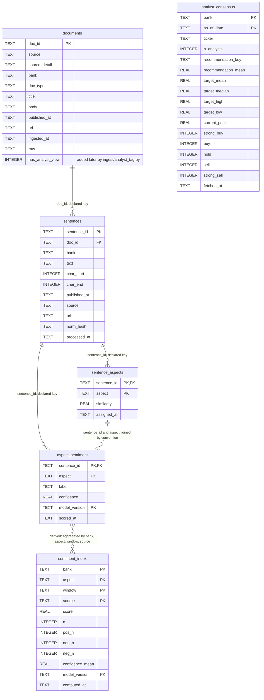

# Data model

The six tables in `data/plp.db`, their columns and keys, and how they relate. For anyone querying the database or reading the report's data section.

**Legend.** Solid shapes and arrows are built and running. Dashed shapes and arrows labelled *planned* are decided but not yet built, with the DESIGN.md decision that records them. Shapes marked *not installed* exist in the repository but aren't running anywhere.

Rendered for the report: [SVG](img/03-data-model.svg) · [PNG](img/03-data-model.png)

## What this shows and doesn't show

Solid lines are the three foreign keys the schema declares. They are **not
enforced**: SQLite checks foreign keys only when `PRAGMA foreign_keys=ON`, and no code
turns it on. Dashed lines are relationships the code relies on without a key: sentiment
rows match aspect rows on `(sentence_id, aspect)`, and `sentiment_index` is recomputed
from `aspect_sentiment` joined to `sentences` each time the index runs.
`analyst_consensus` has no relationship; it shares only the bank name with the rest.

Columns are exactly those of the live database (`schema-2026-09-26.txt`). One differs
from the code's `CREATE TABLE`: `documents.has_analyst_view` is added afterwards by
`ingest/analyst_tag.py` with `ALTER TABLE`, so a database built from `ingest/db.py` alone
lacks it.

Rows in the schema dump, taken on 2026-09-26 before CNA was loaded: documents 27,795;
sentences 42,746; sentence_aspects 90,117; aspect_sentiment 90,117; sentiment_index 257;
analyst_consensus 14. Loading CNA the same day added rows but changed no table or column;
current counts are in `docs/STATUS.md`.

## Sources

Each row names the file and line an element comes from, and the text that line must contain; `check_sources.py` verifies them.

| element | source | symbol checked |
|---|---|---|
| documents, created | `ingest/db.py:20` | `CREATE TABLE IF NOT EXISTS documents (` |
| sentences, created | `ingest/db.py:41` | `CREATE TABLE IF NOT EXISTS sentences (` |
| sentences key to documents | `ingest/db.py:43` | `doc_id         TEXT NOT NULL REFERENCES documents(doc_id)` |
| analyst_consensus, created | `ingest/db.py:61` | `CREATE TABLE IF NOT EXISTS analyst_consensus (` |
| sentence_aspects, created | `aspects/assign.py:40` | `CREATE TABLE IF NOT EXISTS sentence_aspects (` |
| aspect_sentiment, created | `sentiment/score.py:43` | `CREATE TABLE IF NOT EXISTS aspect_sentiment (` |
| sentiment_index, created | `aggregate/index.py:78` | `CREATE TABLE IF NOT EXISTS sentiment_index (` |
| has_analyst_view added later | `ingest/analyst_tag.py:77` | `ALTER TABLE documents ADD COLUMN has_analyst_view` |
| join by sentence_id and aspect | `sentiment/score.py:100` | `ase.sentence_id = sa.sentence_id AND ase.aspect = sa.aspect` |
| index derived from aspect_sentiment | `aggregate/index.py:100` | `FROM aspect_sentiment ase` |
| index joins sentences | `aggregate/index.py:101` | `JOIN sentences sa ON sa.sentence_id = ase.sentence_id` |
| foreign keys not enforced | `docs/diagrams/schema-2026-09-26.txt:114` | `PRAGMA foreign_keys (enforcement on this connection): 0` |
| sentence_aspects key to sentences | `aspects/assign.py:41` | `sentence_id  TEXT NOT NULL REFERENCES sentences(sentence_id)` |
| aspect_sentiment key to sentences | `sentiment/score.py:44` | `sentence_id   TEXT NOT NULL REFERENCES sentences(sentence_id)` |
