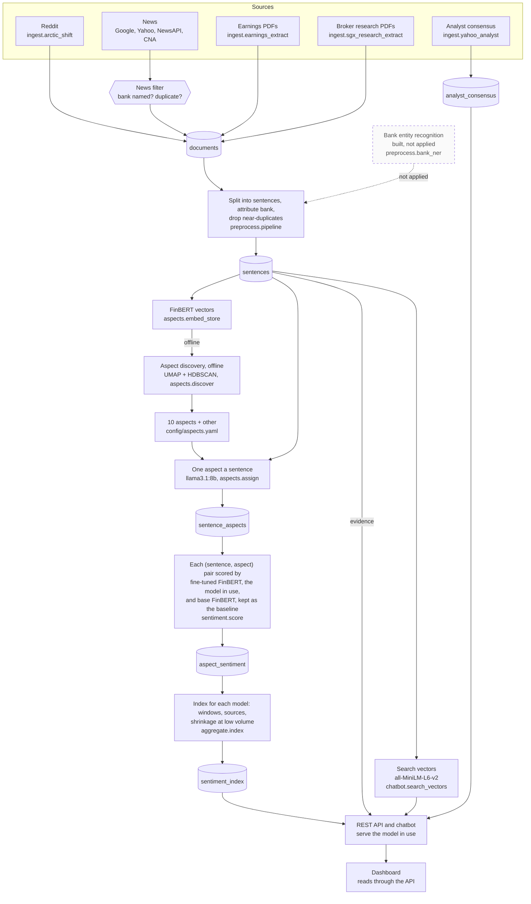

# Pipeline: from sources to the dashboard

How text becomes a sentiment score, stage by stage, and what each stage writes. For the report's solution-approach section.

**Legend.** Solid shapes and arrows are built and running. Dashed shapes and arrows labelled *planned* are decided but not yet built, with the DESIGN.md decision that records them. Shapes marked *not installed* exist in the repository but aren't running anywhere.

Rendered for the report: [SVG](img/04-pipeline.svg) · [PNG](img/04-pipeline.png)

## What this shows and doesn't show

Each arrow is a step someone runs, by hand in RUNBOOK's order or from the dashboard
([02](02-runtime.md)). Every step between ingestion and the index processes only rows it
hasn't processed before; the index is recomputed in full each time (see
[06](06-batch-pipeline.md)). Discovery ran offline to choose the aspects and writes nothing
to the pipeline's tables (`docs/evidence/aspect-discovery-2026-09-11.md`).

Each sentence gets one aspect from `llama3.1:8b`, which agrees with people on 73.9% of the
1,277 sentences they labelled; the earlier method, FinBERT vectors against each aspect's
seed terms, is kept only for that comparison ([22](22-aspect-method-development.md)). Every
pair is scored twice, by the fine-tuned model in use and by base FinBERT as the baseline,
and the index is computed for both; the API and the chatbot serve only the model in use
(`config/model_version.py`). On the 299 test sentences people labelled, the model in use
scores macro-F1 0.670 against base FinBERT's 0.571 (`docs/model-card.md`).

Bank entity recognition (dashed) is built, with unit tests, but not applied: preprocessing
still matches bank names, and its gold sheet is not yet labelled. The chatbot's evidence
search uses its own vectors, from a model built for search, when no topic is named.
Earnings PDFs are fetched by two modules (`earnings_fetch_ir`, `earnings_fetch_uob`)
before `earnings_extract` reads them; the fetch step is folded into the source box. Broker
research PDFs are added to `data/sgx_research/` by the team.

## Sources

Each row names the file and line an element comes from, and the text that line must contain; `check_sources.py` verifies them.

| element | source | symbol checked |
|---|---|---|
| Reddit adapter | `ingest/arctic_shift.py:40` | `BASE_URL = "https://arctic-shift` |
| news filter | `ingest/news_filter.py:258` | `def filter_and_dedup(` |
| news sources | `ingest/news_filter.py:54` | `NEWS_SOURCES = ("newsapi", "alphavantage", "yahoo_news", "google_news", "cna")` |
| broker research PDFs | `ingest/sgx_research_extract.py:4` | `Reads whatever is in data/sgx_research/*.pdf` |
| consensus writes analyst_consensus | `ingest/yahoo_analyst.py:146` | `def upsert(rows` |
| preprocessing | `preprocess/pipeline.py:97` | `def run(sources: set[str]` |
| bank attribution per sentence | `preprocess/pipeline.py:67` | `def _resolve_sentence_bank(` |
| bank names matched, not recognised | `preprocess/pipeline.py:71` | `found = detect_banks(sentence_text)` |
| bank entity recognition, built | `preprocess/bank_ner.py:2` | `Bank entity recognition and resolution` |
| sentence splitting | `preprocess/segment.py:62` | `def segment(text: str)` |
| FinBERT vectors | `aspects/embed_store.py:61` | `def update(path: str | None = None, embed=None, width: int = 768) -> dict:` |
| FinBERT embedding model | `aspects/embed.py:19` | `MODEL_NAME = "ProsusAI/finbert"` |
| discovery: UMAP | `aspects/discover.py:90` | `reducer = umap.UMAP(` |
| discovery: HDBSCAN | `aspects/discover.py:95` | `clusterer = hdbscan.HDBSCAN(` |
| the LLM assigns aspects | `config/aspects.yaml:236` | `assignment_method: llm` |
| the LLM | `config/aspects.yaml:244` | `llm_model: "llama3.1:8b"` |
| one aspect for each new sentence | `aspects/assign.py:111` | `rows = _assign_llm(conn, [sentence_ids[i] for i in todo_idx])` |
| sentiment scoring | `sentiment/score.py:110` | `def run(sources: set[str]` |
| base FinBERT, the baseline | `sentiment/score.py:42` | `MODEL_NAME = "ProsusAI/finbert"` |
| the model in use scores new pairs too | `sentiment/score.py:171` | `result["finetuned_scored"] = score_missing(conn, current_model.MODEL_VERSION, now_iso())` |
| the model in use | `config/model_version.py:25` | `MODEL_VERSION = "finbert-adapted-finetuned-2026-10-11-3seed-m0"` |
| index for each model | `aggregate/index.py:285` | `groups[(bank, aspect, source, model_version)].append(item)` |
| index aggregation | `aggregate/index.py:336` | `def run() -> int:` |
| the API serves the model in use | `api/main.py:163` | `(window, current_model.MODEL_VERSION)).fetchall()` |
| search vectors | `config/search_model.py:3` | `MODEL_NAME = "sentence-transformers/all-MiniLM-L6-v2"` |
| search vectors kept up to date | `aspects/assign.py:98` | `update_search_vectors()` |
| evidence read by the chatbot | `chatbot/retrieval.py:175` | `all_ids, all_vecs = load_for_search()` |
| test result of the model in use | `docs/model-card.md:53` | `| | **three seeds averaged** | **0.716** | **0.670** |` |
| aspect agreement with people | `docs/evidence/wealth-definition-trial-2026-10-12.md:53` | `| People, older reading | 1,277 | 72.9% | 73.9% |` |
| the dashboard reads through the API | `dashboard/api_client.py:39` | `base_url = (os.getenv("PLP_API_URL") or default_url).rstrip("/")` |

## Built, not applied

| element | recorded in |
|---|---|
| Bank entity recognition | DESIGN.md decision 18; `docs/evidence/bank-ner-2026-10-01.md` |
