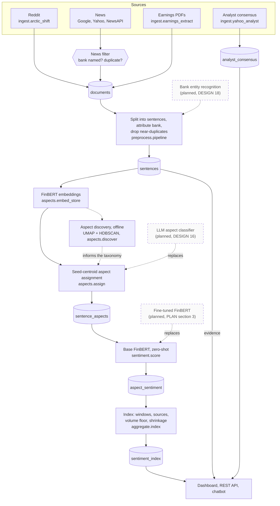

# Pipeline: from sources to the dashboard

How text becomes a sentiment score, stage by stage, and what each stage writes. For the report's solution-approach section.

**Legend.** Solid shapes and arrows are built and running. Dashed shapes and arrows labelled *planned* are decided but not yet built, with the DESIGN.md decision that records them. Shapes marked *not installed* exist in the repository but aren't running anywhere.

Rendered for the report: [SVG](img/04-pipeline.svg) · [PNG](img/04-pipeline.png)

## What this shows and doesn't show

Each arrow is a step someone runs; RUNBOOK lists them in order. Every step after
ingestion processes only rows it hasn't processed before (see
[06](06-batch-pipeline.md)). Discovery runs offline and doesn't write to the pipeline's
tables: its output is evidence for choosing the aspect taxonomy
(`docs/evidence/aspect-discovery-2026-09-11.md`). The three dashed boxes are decided but
not built: bank NER would improve attribution inside preprocessing, the LLM classifier
would replace seed-centroid assignment, and a fine-tuned model would replace zero-shot
scoring once labels exist (its training code, `train/finetune.py`, has never run).
Earnings PDFs are fetched by two modules (`earnings_fetch_ir`, `earnings_fetch_uob`)
before `earnings_extract` reads them; the fetch step is folded into the source box.

## Sources

Each row names the file and line an element comes from, and the text that line must contain; `check_sources.py` verifies them.

| element | source | symbol checked |
|---|---|---|
| Reddit adapter | `ingest/arctic_shift.py:40` | `BASE_URL = "https://arctic-shift` |
| news filter | `ingest/news_filter.py:245` | `def filter_and_dedup(` |
| consensus writes analyst_consensus | `ingest/yahoo_analyst.py:131` | `def upsert(rows` |
| preprocessing | `preprocess/pipeline.py:87` | `def run() -> dict:` |
| bank attribution per sentence | `preprocess/pipeline.py:59` | `def _resolve_sentence_bank(` |
| sentence splitting | `preprocess/segment.py:35` | `def segment(text: str)` |
| embeddings | `aspects/embed_store.py:47` | `def update() -> dict:` |
| FinBERT embedding model | `aspects/embed.py:15` | `MODEL_NAME = "ProsusAI/finbert"` |
| discovery: UMAP | `aspects/discover.py:90` | `reducer = umap.UMAP(` |
| discovery: HDBSCAN | `aspects/discover.py:95` | `clusterer = hdbscan.HDBSCAN(` |
| assignment from seed centroids | `aspects/assign.py:61` | `vecs = embed_sentences(cfg["seed_terms"])` |
| sentiment scoring | `sentiment/score.py:89` | `def run() -> dict:` |
| zero-shot base FinBERT | `sentiment/score.py:37` | `MODEL_NAME = "ProsusAI/finbert"` |
| index aggregation | `aggregate/index.py:225` | `def run() -> int:` |
| fine-tuning code, never run | `train/finetune.py:94` | `def run(seed: int = 42` |
| evidence read by the chatbot | `chatbot/retrieval.py:98` | `all_ids, all_vecs = load_for_search()` |

## Planned elements

| element | recorded in |
|---|---|
| Bank entity recognition | DESIGN.md decision 18 |
| LLM aspect classifier | DESIGN.md decision 16 |
| Fine-tuned FinBERT | PLAN.md section 3 (the DNN); blocked on labelling |
