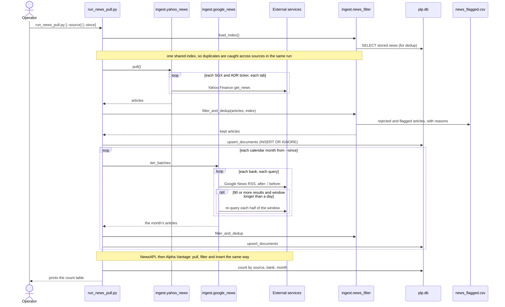

# News ingestion, one run

What happens, in order, when someone runs `run_news_pull.py`: which service is called, where articles are filtered and deduplicated, and what is written. For anyone extending or re-running the news pull.

**Legend.** Solid shapes and arrows are built and running. Dashed shapes and arrows labelled *planned* are decided but not yet built, with the DESIGN.md decision that records them. Shapes marked *not installed* exist in the repository but aren't running anywhere.

Rendered for the report: [SVG](img/05-news-ingestion.svg) · [PNG](img/05-news-ingestion.png)

## What this shows and doesn't show

The order of sources is deliberate: the first copy of a duplicated story is the one
kept, so Yahoo, which carries a summary, goes first. Retries on network errors are left
out; `request_with_retries` backs off and tries again up to three times. NewsAPI and Alpha
Vantage are folded into one note because they follow exactly the same pull, filter,
insert pattern as Yahoo; Alpha Vantage returns nothing for SGX tickers. What the filter
decides for each article is [11](11-news-filter.md).

## Sources

Each row names the file and line an element comes from, and the text that line must contain; `check_sources.py` verifies them.

| element | source | symbol checked |
|---|---|---|
| run(): one shared index | `run_news_pull.py:51` | `index = load_index()` |
| load_index reads stored news | `ingest/news_filter.py:243` | `def load_index() -> _Index:` |
| Yahoo first | `run_news_pull.py:55` | `_ingest("yahoo_news", yahoo_news.pull(), index)` |
| each ticker | `ingest/yahoo_news.py:90` | `for ticker in tickers:` |
| each tab | `ingest/yahoo_news.py:91` | `for tab in TABS:` |
| filter then insert | `run_news_pull.py:44` | `kept, stats = filter_and_dedup(docs, index)` |
| insert | `run_news_pull.py:45` | `_, inserted = upsert_documents(kept)` |
| INSERT OR IGNORE | `ingest/db.py:132` | `INSERT OR IGNORE INTO documents` |
| flagged articles written | `ingest/news_filter.py:316` | `_append_flagged(flagged)` |
| Google month loop | `run_news_pull.py:59` | `for month, docs in google_news.iter_batches(since, until):` |
| each calendar month | `ingest/google_news.py:151` | `for start, end in _months(s, u):` |
| each bank and query | `ingest/google_news.py:153` | `for bank, queries in QUERIES.items():` |
| RSS request | `ingest/google_news.py:113` | `resp = request_with_retries(RSS_URL` |
| split threshold | `ingest/google_news.py:67` | `SPLIT_AT = 90` |
| split and re-query | `ingest/google_news.py:127` | `if len(entries) >= SPLIT_AT and (end - start).days > 1:` |
| NewsAPI next | `run_news_pull.py:64` | `_ingest("newsapi", newsapi.pull(), index)` |
| Alpha Vantage last | `run_news_pull.py:67` | `_ingest("alphavantage", alphavantage.pull(), index)` |
| count table printed | `run_news_pull.py:119` | `print(count_table())` |
