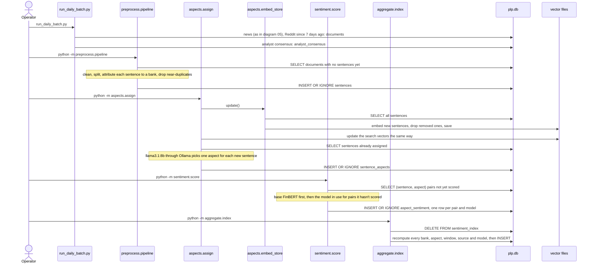

# A batch run, from ingestion to the index

The order in which an operator runs the batch steps, what each reads and writes, and why re-running is safe. For whoever refreshes the data before a demo or the report.

**Legend.** Solid shapes and arrows are built and running. Dashed shapes and arrows labelled *planned* are decided but not yet built, with the DESIGN.md decision that records them. Shapes marked *not installed* exist in the repository but aren't running anywhere.

Rendered for the report: [SVG](img/06-batch-pipeline.svg) · [PNG](img/06-batch-pipeline.png)

## What this shows and doesn't show

Steps are run by hand, in this order; each consumes the previous step's output. Every
step up to scoring works only on rows it hasn't seen (a `NOT EXISTS` query or an
already-assigned set, then `INSERT OR IGNORE`), so an interrupted run can simply be
re-run. The index is the exception: it is cheap, so it is deleted and rebuilt each time.
The daily job that would run the first step on a schedule is not installed, and
collection stopped on 26 Sep 2026. Broker research PDFs are read by their own command
(`python -m ingest.sgx_research_extract`). The same steps can be started from the
dashboard, which asks the API to run them in a worker in this order (`POST /pipeline/runs`,
`pipeline/runner.py`; `docs/manual-pipeline.md`). Aspect assignment needs Ollama running
for `llama3.1:8b`; scoring writes base FinBERT's rows first, then the rows of the model in
use for every pair that lacks them, so neither model's index misses a sentence.

## Sources

Each row names the file and line an element comes from, and the text that line must contain; `check_sources.py` verifies them.

| element | source | symbol checked |
|---|---|---|
| news in the daily batch | `run_daily_batch.py:45` | `news_totals = run_news(` |
| Reddit since 7 days ago | `run_daily_batch.py:51` | `since = reddit_since or (datetime.now(timezone.utc) - timedelta(days=7))` |
| Reddit pull | `run_daily_batch.py:52` | `docs = arctic_shift.pull(since=since)` |
| consensus | `run_daily_batch.py:58` | `consensus_rows = yahoo_analyst.pull()` |
| documents without sentences | `preprocess/pipeline.py:87` | `WHERE NOT EXISTS (SELECT 1 FROM sentences s WHERE s.doc_id = d.doc_id)` |
| split | `preprocess/pipeline.py:112` | `for sent_text, start, end in segment(cleaned):` |
| attribute bank | `preprocess/pipeline.py:116` | `bank = _resolve_sentence_bank(sent_text` |
| drop near-duplicates | `preprocess/pipeline.py:121` | `if h in seen_hashes:` |
| insert sentences | `preprocess/pipeline.py:134` | `INSERT OR IGNORE INTO sentences` |
| assign refreshes embeddings first | `aspects/assign.py:97` | `update_embeddings()` |
| embed new sentences | `aspects/embed_store.py:88` | `new_vecs = embed([r[1] for r in new_rows])` |
| drop removed ones | `aspects/embed_store.py:79` | `pruned = len(existing_ids)` |
| save the cache | `aspects/embed_store.py:96` | `_save_store(all_ids, all_vecs, path)` |
| already assigned | `aspects/assign.py:105` | `already = {r[0] for r in conn.execute(` |
| search vectors refreshed | `aspects/assign.py:98` | `update_search_vectors()` |
| the LLM picks one aspect | `aspects/assign.py:111` | `rows = _assign_llm(conn, [sentence_ids[i] for i in todo_idx])` |
| the LLM | `config/aspects.yaml:244` | `llm_model: "llama3.1:8b"` |
| insert aspects | `aspects/assign.py:132` | `INSERT OR IGNORE INTO sentence_aspects` |
| pairs not yet scored | `sentiment/score.py:120` | `WHERE NOT EXISTS (` |
| classify, once per sentence | `sentiment/score.py:145` | `predictions = classify_sentences([text_of[i] for i in chunk])` |
| insert scores | `sentiment/score.py:151` | `INSERT OR IGNORE INTO aspect_sentiment` |
| then the model in use | `sentiment/score.py:171` | `result["finetuned_scored"] = score_missing(conn, current_model.MODEL_VERSION, now_iso())` |
| the same steps from the dashboard | `pipeline/runner.py:244` | `"preprocess": stages.preprocess,` |
| full recompute | `aggregate/index.py:325` | `conn.execute("DELETE FROM sentiment_index")` |
| insert index rows | `aggregate/index.py:327` | `INSERT INTO sentiment_index` |
