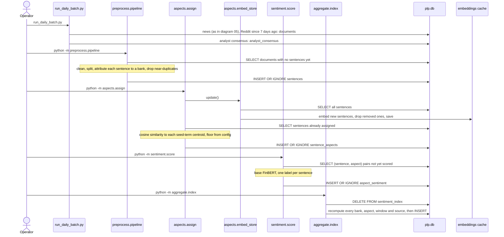

# A batch run, from ingestion to the index

The order in which an operator runs the batch steps, what each reads and writes, and why re-running is safe. For whoever refreshes the data before a demo or the report.

**Legend.** Solid shapes and arrows are built and running. Dashed shapes and arrows labelled *planned* are decided but not yet built, with the DESIGN.md decision that records them. Shapes marked *not installed* exist in the repository but aren't running anywhere.

Rendered for the report: [SVG](img/06-batch-pipeline.svg) · [PNG](img/06-batch-pipeline.png)

## What this shows and doesn't show

Steps are run by hand, in this order; each consumes the previous step's output. Every
step up to scoring works only on rows it hasn't seen (a `NOT EXISTS` query or an
already-assigned set, then `INSERT OR IGNORE`), so an interrupted run can simply be
re-run. The index is the exception: it is cheap, so it is deleted and rebuilt each time.
The daily job that would run the first step on a schedule is not installed. Planned
changes to the assignment and scoring steps are shown in [04](04-pipeline.md).

## Sources

Each row names the file and line an element comes from, and the text that line must contain; `check_sources.py` verifies them.

| element | source | symbol checked |
|---|---|---|
| news in the daily batch | `run_daily_batch.py:41` | `news_totals = run_news(` |
| Reddit since 7 days ago | `run_daily_batch.py:47` | `since = reddit_since or (datetime.now(timezone.utc) - timedelta(days=7))` |
| Reddit pull | `run_daily_batch.py:48` | `docs = arctic_shift.pull(since=since)` |
| consensus | `run_daily_batch.py:54` | `consensus_rows = yahoo_analyst.pull()` |
| documents without sentences | `preprocess/pipeline.py:80` | `WHERE NOT EXISTS (SELECT 1 FROM sentences s WHERE s.doc_id = d.doc_id)` |
| split | `preprocess/pipeline.py:105` | `for sent_text, start, end in segment(cleaned):` |
| attribute bank | `preprocess/pipeline.py:109` | `bank = _resolve_sentence_bank(sent_text` |
| drop near-duplicates | `preprocess/pipeline.py:114` | `if h in seen_hashes:` |
| insert sentences | `preprocess/pipeline.py:127` | `INSERT OR IGNORE INTO sentences` |
| assign refreshes embeddings first | `aspects/assign.py:76` | `update_embeddings()` |
| embed new sentences | `aspects/embed_store.py:69` | `new_vecs = embed_sentences(` |
| drop removed ones | `aspects/embed_store.py:63` | `pruned = len(existing_ids)` |
| save the cache | `aspects/embed_store.py:77` | `_save_store(all_ids, all_vecs)` |
| already assigned | `aspects/assign.py:83` | `already = {r[0] for r in conn.execute(` |
| cosine to centroids | `aspects/assign.py:91` | `sims = {aspect: _cosine(vec, centroid)` |
| insert aspects | `aspects/assign.py:105` | `INSERT OR IGNORE INTO sentence_aspects` |
| pairs not yet scored | `sentiment/score.py:109` | `WHERE NOT EXISTS (` |
| classify, once per sentence | `sentiment/score.py:135` | `predictions = classify_sentences([text_of[i] for i in chunk])` |
| insert scores | `sentiment/score.py:141` | `INSERT OR IGNORE INTO aspect_sentiment` |
| full recompute | `aggregate/index.py:264` | `conn.execute("DELETE FROM sentiment_index")` |
| insert index rows | `aggregate/index.py:266` | `INSERT INTO sentiment_index` |
