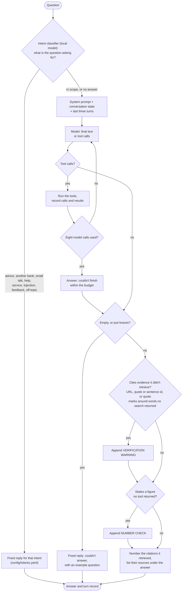

# Chatbot: one turn

Every path a question can take through the chatbot, including the points where code, not the model, decides the answer. For the report's conversational-UI section and for anyone changing the chatbot.

**Legend.** Solid shapes and arrows are built and running. Dashed shapes and arrows labelled *planned* are decided but not yet built, with the DESIGN.md decision that records them. Shapes marked *not installed* exist in the repository but aren't running anywhere.

Rendered for the report: [SVG](img/07-chatbot-turn.svg) · [PNG](img/07-chatbot-turn.png)

## What this shows and doesn't show

The intent classifier is its own local model with fixed replies, and the three checks are
code, so they behave the same whichever chatbot model runs (`chatbot/intent.py`,
`chatbot/guards.py`, DESIGN decisions 19 and 24). If the classifier can't answer, the
question goes on to the model, whose prompt still says to decline advice and unrelated
questions. Everything between "System prompt" and
"Tool calls?" is the model's own behaviour. Warnings are appended, not substituted: a
flagged answer is still shown, with the warning under it. Quote marks around words no search
returned count as unretrieved evidence, whatever shape they take, but for a word or two in
quote marks, an inch mark and an apostrophe. With `CHATBOT_ENFORCE_EVIDENCE` at strip, the
default, the quotes, links and sentence ids no search returned are removed first, with their
citations, and stray numbered markers the model wrote are dropped; then the quote marks come off
everything else no search returned, the words staying (DESIGN decision 26), so the citation
check has nothing left to warn about (`chatbot/agent.py`, `enforce_evidence`); the diagram
shows the checks, not the removal. The eight-call cap is per
backend; Ollama's is shown and the others use the same value. Evaluation results for this
design are in `docs/evidence/chatbot-harness-2026-09-26.md`; the numbered sources and
the answers' wording, in `docs/evidence/chatbot-answers-2026-10-04.md`.

## Sources

Each row names the file and line an element comes from, and the text that line must contain; `check_sources.py` verifies them.

| element | source | symbol checked |
|---|---|---|
| intent classifier runs first | `chatbot/agent.py:1536` | `intent = intents.classify_intent(question, state, previous)` |
| classifier | `chatbot/intent.py:106` | `def classify_intent(question: str` |
| fixed reply for the intent | `chatbot/intent.py:125` | `def reply_for(intent` |
| state and turns passed to the model | `chatbot/agent.py:1548` | `answer = backend.ask(question, with_state(SYSTEM_PROMPT, state)` |
| state added to the system prompt | `chatbot/prompts.py:84` | `def with_state(system: str` |
| last three turns | `config/chatbot.yaml:36` | `turns:        {value: 3}` |
| tool-call loop, eight calls | `config/chatbot.yaml:22` | `max_tool_iterations: {value: 8}` |
| loop | `chatbot/backends/ollama_backend.py:84` | `for _ in range(MAX_TOOL_ITERATIONS):` |
| tool calls? | `chatbot/backends/ollama_backend.py:89` | `tool_calls = message.get("tool_calls") or []` |
| run the tools | `chatbot/backends/ollama_backend.py:106` | `result_json = tool_executor(name, arguments)` |
| record calls and results | `chatbot/agent.py:677` | `def execute(self, name: str, tool_input: dict, by: str = "model")` |
| budget message | `chatbot/backends/ollama_backend.py:113` | `within the tool-call budget` |
| empty answer check | `chatbot/agent.py:1550` | `if not (answer or "").strip(` |
| empty answer replaced, checks skipped | `chatbot/agent.py:1553` | `return TurnResult(question=question, answer=EMPTY_ANSWER_REPLY` |
| citation check | `chatbot/agent.py:1557` | `enforced, flagged = enforce_evidence(answer, tracker, question, mode)` |
| sentence ids checked | `chatbot/agent.py:788` | `unverified_sentence_ids(answer, self.known_ids())` |
| quote marks around words no search returned | `chatbot/agent.py:816` | `return self.cites_unretrieved(text) or _demark(text, self) != text` |
| marks taken off in strip mode | `chatbot/agent.py:1444` | `cleaned = _demark(text, tracker)` |
| figure check | `chatbot/agent.py:1585` | `figures = unverified_numbers(` |
| number warning appended | `chatbot/agent.py:1591` | `result.answer += UNVERIFIED_NUMBER_WARNING.format(` |
| citations numbered, sources listed | `chatbot/agent.py:1593` | `result.answer = number_citations(result.answer, tracker)` |
