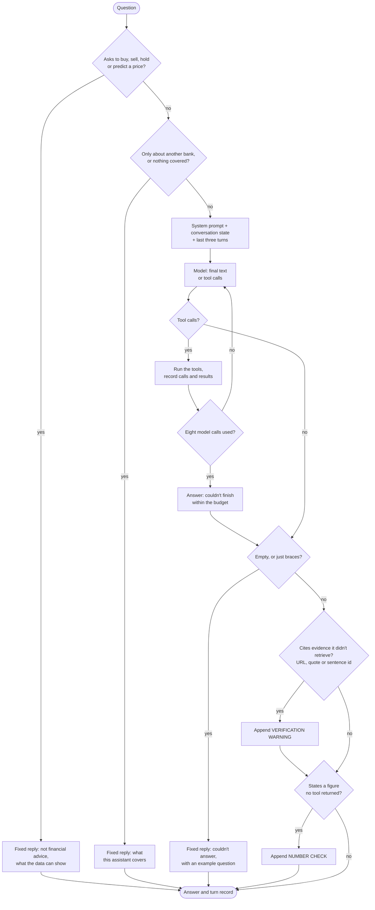

# Chatbot: one turn

Every path a question can take through the chatbot, including the points where code, not the model, decides the answer. For the report's conversational-UI section and for anyone changing the chatbot.

**Legend.** Solid shapes and arrows are built and running. Dashed shapes and arrows labelled *planned* are decided but not yet built, with the DESIGN.md decision that records them. Shapes marked *not installed* exist in the repository but aren't running anywhere.

Rendered for the report: [SVG](img/07-chatbot-turn.svg) · [PNG](img/07-chatbot-turn.png)

## What this shows and doesn't show

The two guards and the three checks are code, so they behave the same whichever model
runs (`chatbot/guards.py`, DESIGN decision 19). Everything between "System prompt" and
"Tool calls?" is the model's own behaviour. Warnings are appended, not substituted: a
flagged answer is still shown, with the warning under it. The eight-call cap is per
backend; Ollama's is shown and the others use the same value. Evaluation results for this
design are in `docs/evidence/chatbot-harness-2026-09-26.md`.

## Sources

Each row names the file and line an element comes from, and the text that line must contain; `check_sources.py` verifies them.

| element | source | symbol checked |
|---|---|---|
| guards run first, advice then scope | `chatbot/agent.py:258` | `for guard, reply in (("advice", advice_reply(question, context_banks)),` |
| advice guard | `chatbot/guards.py:66` | `def advice_reply(question: str` |
| scope guard | `chatbot/guards.py:106` | `def scope_reply(question: str, in_conversation: bool = False)` |
| state and turns passed to the model | `chatbot/agent.py:270` | `answer = backend.ask(question, with_state(SYSTEM_PROMPT, state)` |
| state added to the system prompt | `chatbot/prompts.py:46` | `def with_state(system: str` |
| last three turns | `chatbot/agent.py:107` | `HISTORY_TURNS = 3` |
| tool-call loop, eight calls | `chatbot/backends/ollama_backend.py:39` | `MAX_TOOL_ITERATIONS = 8` |
| loop | `chatbot/backends/ollama_backend.py:82` | `for _ in range(MAX_TOOL_ITERATIONS):` |
| tool calls? | `chatbot/backends/ollama_backend.py:87` | `tool_calls = message.get("tool_calls") or []` |
| run the tools | `chatbot/backends/ollama_backend.py:104` | `result_json = tool_executor(name, arguments)` |
| record calls and results | `chatbot/agent.py:124` | `def execute(self, name: str, tool_input: dict, by: str = "model")` |
| budget message | `chatbot/backends/ollama_backend.py:111` | `within the tool-call budget` |
| empty answer check | `chatbot/agent.py:272` | `if not (answer or "").strip(` |
| empty answer replaced, checks skipped | `chatbot/agent.py:275` | `return TurnResult(question=question, answer=EMPTY_ANSWER_REPLY` |
| citation check | `chatbot/agent.py:279` | `enforced, flagged = enforce_evidence(answer, tracker, question, mode)` |
| sentence ids checked | `chatbot/agent.py:151` | `if unverified_sentence_ids(answer, self.verified_sentence_ids):` |
| figure check | `chatbot/agent.py:292` | `figures = unverified_numbers(` |
| number warning appended | `chatbot/agent.py:297` | `result.answer += UNVERIFIED_NUMBER_WARNING.format(` |
