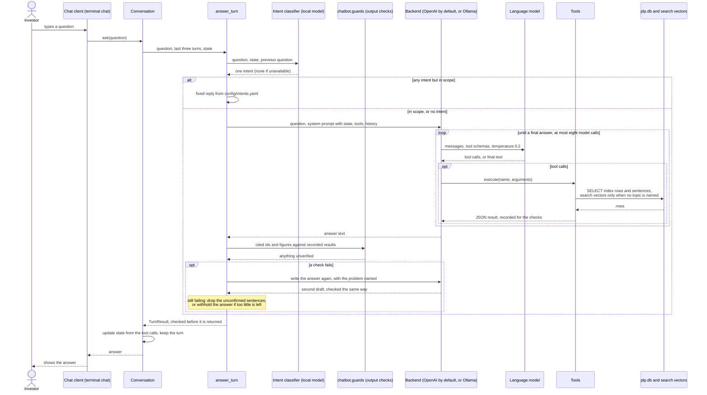

# Chatbot: one turn from a chat client

Which component calls which, in order, when someone asks a question in the terminal chat (`chatbot/chat.py`); `POST /chat` runs the same turn ([13](13-api-chat.md)). For the report's system-design section and for debugging a turn.

**Legend.** Solid shapes and arrows are built and running. Dashed shapes and arrows labelled *planned* are decided but not yet built, with the DESIGN.md decision that records them. Shapes marked *not installed* exist in the repository but aren't running anywhere.

Rendered for the report: [SVG](img/08-chatbot-sequence.svg) · [PNG](img/08-chatbot-sequence.png)

## What this shows and doesn't show

The REST API follows the same path from `Conversation` onwards, rebuilding the
conversation from the `history` the client sends ([13](13-api-chat.md)). The backend is
OpenAI's `gpt-6-luna` by default; with `CHATBOT_BACKEND=ollama` it is the local
`llama3.1:8b`, and the loop is the same. A hosted backend is never sent Reddit text: it is
withheld from the tool results first (`chatbot/backends/base.py`). The intent classifier
is a separate Ollama call (`chatbot/intent.py`), made whichever backend answers. The
evidence search ranks by the question's words, then the newest, within a topic, and uses
the search vectors only when no topic is named ([07](07-chatbot-turn.md) shows the checks
and the rewrite in full). The citation check that runs alongside the figure check lives in the
tool-call tracker in `chatbot/agent.py`. The model's own reasoning between calls is not shown.

## Sources

Each row names the file and line an element comes from, and the text that line must contain; `check_sources.py` verifies them.

| element | source | symbol checked |
|---|---|---|
| chat client hands over the question | `chatbot/chat.py:83` | `last = conv.ask(q)` |
| Conversation.ask | `chatbot/agent.py:2511` | `def ask(self, question: str, verbose: bool = False, on_step=None)` |
| last three turns and state | `chatbot/agent.py:2513` | `r = answer_turn(question, backend_name=self.backend_name, history=self.history(),` |
| intent classifier first | `chatbot/agent.py:2325` | `intent = intents.classify_intent(question, state, previous)` |
| fixed reply | `chatbot/agent.py:2326` | `reply = intents.reply_for(intent, question, state)` |
| backend chosen | `chatbot/agent.py:2336` | `backend = backend or get_backend(backend_name)` |
| OpenAI by default | `config/chatbot.yaml:5` | `backend:          {value: "openai", env: CHATBOT_BACKEND}` |
| model call, OpenAI | `chatbot/backends/openai_backend.py:127` | `data = self._chat(messages, openai_tools)` |
| model call, Ollama | `chatbot/backends/ollama_backend.py:171` | `self._chat(messages, ollama_tools)` |
| temperature 0.2 | `config/chatbot.yaml:6` | `temperature:      {value: 0.2, env: CHATBOT_TEMPERATURE}` |
| temperature sent | `chatbot/backends/openai_backend.py:68` | `"temperature": self.temperature}` |
| Reddit text withheld from a hosted model | `chatbot/backends/openai_backend.py:150` | `withheld_tool_result(name, result_json)` |
| tool executed and recorded | `chatbot/agent.py:815` | `result = fn(**coerce_tool_arguments(name, tool_input))` |
| tools read the database | `chatbot/tools.py:77` | `def get_sentiment(bank: str` |
| within a topic: words, then newest | `chatbot/retrieval.py:162` | `settings.get("evidence.within_topic") == "words_then_newest"` |
| without a topic: search vectors | `chatbot/retrieval.py:180` | `query_vec = embed_sentences([rank_text])[0]` |
| figures checked against results | `chatbot/agent.py:2257` | `figures = unverified_numbers(checked, results, question)` |
| written again, with the problem named | `chatbot/agent.py:2372` | `system = base_system + REWRITE_NOTE.format(` |
| unconfirmed sentences dropped | `chatbot/agent.py:2289` | `def _trim_unverified(` |
| state updated | `chatbot/agent.py:2515` | `self._update_state(r)` |
| turn kept | `chatbot/agent.py:2516` | `self.turns.append(r)` |
