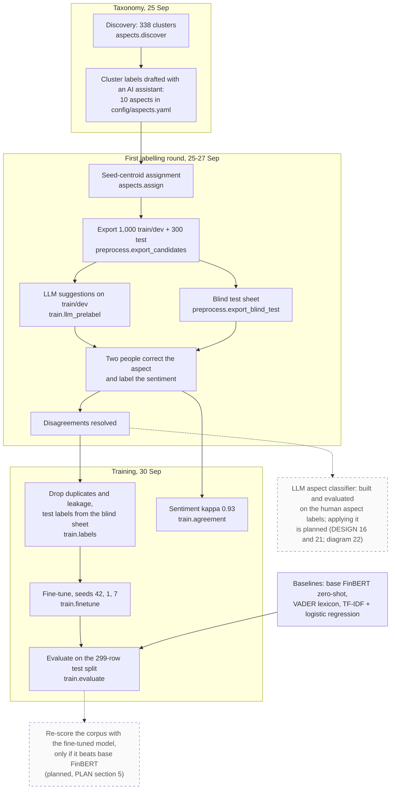

# Labelling and training

How the labelled data was produced and turned into the fine-tuned model and its evaluation, and what is still planned. For the report's methodology section, and for the team, since this is the critical path.

**Legend.** Solid shapes and arrows are built and running. Dashed shapes and arrows labelled *planned* are decided but not yet built, with the DESIGN.md decision that records them. Shapes marked *not installed* exist in the repository but aren't running anywhere.

Rendered for the report: [SVG](img/09-labelling-training.svg) · [PNG](img/09-labelling-training.png)

## What this shows and doesn't show

Every solid step has run. The candidates were stratified within a 12,000-pair sample
scored on Colab, not the whole corpus. Annotators corrected the aspect once and shared it,
so only sentiment agreement was measured (kappa 0.93), and each annotator's blind test
labels match their labels on the same rows in the candidates sheet, where the LLM's
suggestion was visible, so the test labels are not independent of it. Cleaning removed 18
duplicate rows and 5 sentences that were in both splits. Fine-tuning scored macro-F1 0.547 ±
0.013 against base FinBERT zero-shot's 0.571, so the corpus is still scored by base FinBERT.
Version 1 of the candidate sheet (September, four aspects) was never labelled and is not
drawn.

## Sources

Each row names the file and line an element comes from, and the text that line must contain; `check_sources.py` verifies them.

| element | source | symbol checked |
|---|---|---|
| discovery | `aspects/discover.py:49` | `def run(min_cluster_size: int = 10)` |
| 338 clusters | `docs/evidence/aspect-taxonomy-2026-09-25.md:11` | `338 clusters, 27,949 noise points (65%)` |
| labels drafted with an AI assistant | `docs/evidence/aspect-taxonomy-2026-09-25.md:16` | `notes record that an AI assistant (Claude, in a chat session) drafted` |
| assignment | `aspects/assign.py:94` | `def run() -> dict:` |
| export candidates | `preprocess/export_candidates.py:59` | `def export(train_dev_target: int` |
| LLM suggestions | `train/llm_prelabel.py:146` | `def run(model: str = DEFAULT_MODEL` |
| blind test sheet | `preprocess/export_blind_test.py:104` | `def export_blind(` |
| clean the labels | `train/labels.py:130` | `def prepare(candidates_path: str, blind_path: str, out_path: str,` |
| agreement | `train/agreement.py:125` | `def score(pairs: pd.DataFrame` |
| kappa 0.93 | `docs/evidence/annotation-agreement-2026-09-27.md:34` | `| candidates, both splits | 1,277 | 0.952 | **0.926** |` |
| fine-tune | `train/finetune.py:250` | `def run(seed: int = 42` |
| evaluate | `train/evaluate.py:134` | `def run(model_dir: str` |
| baseline: base FinBERT | `train/evaluate.py:47` | `def eval_base_finbert_zeroshot(` |
| baseline: lexicon | `train/evaluate.py:56` | `def eval_lexicon(` |
| baseline: TF-IDF + logistic regression | `train/evaluate.py:71` | `def eval_tfidf_logreg(` |
| result | `docs/evidence/finetune-2026-09-30.md:28` | `| fine-tuned FinBERT, 3 seeds |` |
| sample-stratified candidates | `notebooks/README.md:17` | `Candidates were stratified within that sample` |

## Planned elements

| element | recorded in |
|---|---|
| LLM aspect classifier | DESIGN.md decisions 16 and 21 |
| Re-scoring the corpus | PLAN.md section 5; only if the fine-tuned model beats base FinBERT |
