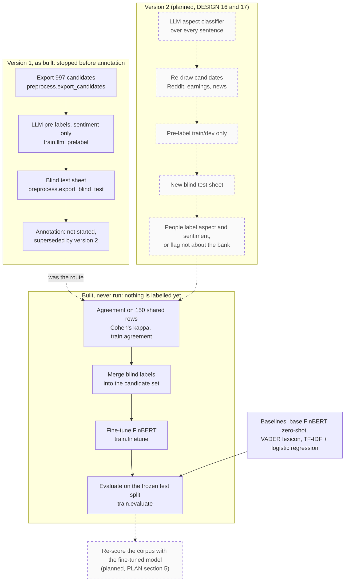

# Labelling and training

How labelled data is produced and turned into the fine-tuned model and its evaluation, as built and as planned. For the report's methodology section, and for the team, since this is the critical path.

**Legend.** Solid shapes and arrows are built and running. Dashed shapes and arrows labelled *planned* are decided but not yet built, with the DESIGN.md decision that records them. Shapes marked *not installed* exist in the repository but aren't running anywhere.

Rendered for the report: [SVG](img/09-labelling-training.svg) · [PNG](img/09-labelling-training.png)

## What this shows and doesn't show

Version 1 got as far as the sheets: 997 candidates, pre-labelled by a local model, with
a blind sheet for the test split. No one has labelled a row, and the team decided on
2026-09-26 not to label that sheet (DESIGN decision 17). Version 2 classifies aspects with
an LLM first (decision 16), so labels attach to the right aspect, then re-draws candidates
including news. Everything in the bottom box is written and tested but has never run, for
lack of labels. Planned in version 2 but not drawn: agreement reported separately for
aspect and sentiment, fine-tuning across at least three seeds, and evaluation of aspect
categorisation and NER alongside sentiment (PLAN section 3).

## Sources

Each row names the file and line an element comes from, and the text that line must contain; `check_sources.py` verifies them.

| element | source | symbol checked |
|---|---|---|
| export candidates | `preprocess/export_candidates.py:59` | `def export(train_dev_target: int` |
| LLM pre-labels | `train/llm_prelabel.py:146` | `def run(model: str = DEFAULT_MODEL` |
| blind test sheet | `preprocess/export_blind_test.py:104` | `def export_blind(` |
| merge blind labels | `preprocess/export_blind_test.py:127` | `def merge_labels(` |
| agreement | `train/agreement.py:179` | `def run(file_a: str | None = None` |
| Cohen's kappa | `train/agreement.py:103` | `def score(pairs: pd.DataFrame)` |
| fine-tune | `train/finetune.py:94` | `def run(seed: int = 42` |
| evaluate | `train/evaluate.py:104` | `def run(model_dir: str | None):` |
| baseline: base FinBERT | `train/evaluate.py:43` | `def eval_base_finbert_zeroshot(` |
| baseline: lexicon | `train/evaluate.py:52` | `def eval_lexicon(` |
| baseline: TF-IDF + logistic regression | `train/evaluate.py:67` | `def eval_tfidf_logreg(` |
| version 1 superseded, don't label | `docs/annotation-guideline.md:7` | `don't label the current` |
| version 2: aspect and sentiment | `docs/PLAN.md:38` | `**Annotators record aspect and sentiment for each sentence**` |
| agreement on 150 shared rows | `docs/PLAN.md:152` | `Two people label the same 150 rows first` |

## Planned elements

| element | recorded in |
|---|---|
| LLM aspect classifier | DESIGN.md decision 16 |
| Re-drawn candidates, aspect + sentiment labelling | DESIGN.md decision 17; PLAN.md section 6 |
| Re-scoring the corpus | PLAN.md section 5, week of 12 Oct |
