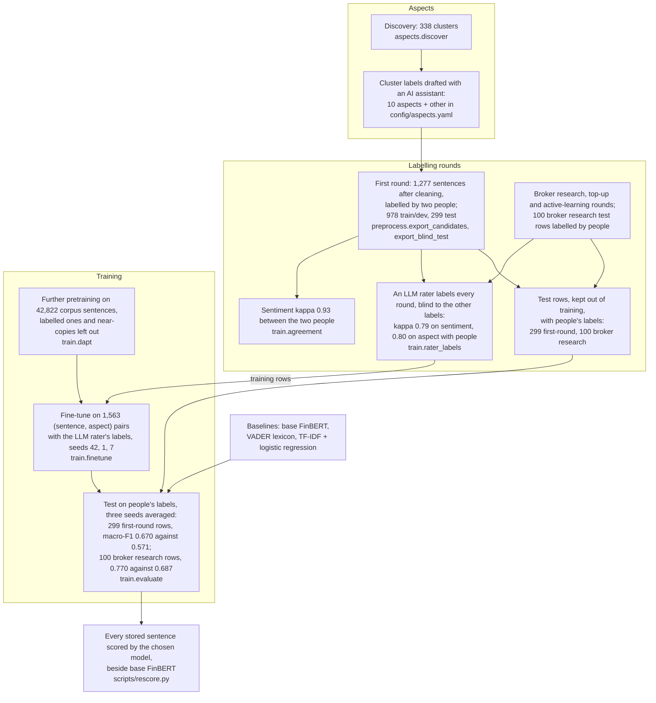

# Labelling and training

How the labelled data was produced and turned into the fine-tuned model in use and its evaluation. For the report's methodology section. Diagram 21 gives the experiments that chose the configuration, with each score.

**Legend.** Solid shapes and arrows are built and running. Dashed shapes and arrows labelled *planned* are decided but not yet built, with the DESIGN.md decision that records them. Shapes marked *not installed* exist in the repository but aren't running anywhere.

Rendered for the report: [SVG](img/09-labelling-training.svg) · [PNG](img/09-labelling-training.png)

## What this shows and doesn't show

Every step has run. The first round's candidates were stratified within a 12,000-pair
sample scored on Colab, not the whole corpus. In that round the annotators corrected the
aspect once and shared it, so only sentiment agreement between the two people was measured
(kappa 0.93). Each annotator's blind test labels match their labels on the same rows in the
candidates sheet, where an LLM's suggestion was visible, so the test labels are not
independent of it. Cleaning removed 18 duplicate rows and 5 sentences that were in both
splits.

The model in use is trained on the LLM rater's labels, not on people's: 1,563 pairs from
four rounds (917 first-round, 275 broker research, 240 top-up, 131 active-learning), after
leaving out the rows the rater flagged as not about the bank. People's labels are used to test it: the
299 first-round test rows and 100 broker research rows, none of them in training, and none
of the labelled sentences in the further pretraining. The first fine-tuning on people's
labels alone scored 0.547 against base FinBERT's 0.571; how the configuration then improved
is diagram [21](21-sentiment-model-development.md). Version 1 of the candidate sheet
(September, four aspects) was never labelled and is not drawn.

## Sources

Each row names the file and line an element comes from, and the text that line must contain; `check_sources.py` verifies them.

| element | source | symbol checked |
|---|---|---|
| discovery | `aspects/discover.py:49` | `def run(min_cluster_size: int = 10)` |
| 338 clusters | `docs/evidence/aspect-taxonomy-2026-09-25.md:11` | `338 clusters, 27,949 noise points (65%)` |
| labels drafted with an AI assistant | `docs/evidence/aspect-taxonomy-2026-09-25.md:16` | `notes record that an AI assistant (Claude, in a chat session) drafted` |
| export candidates | `preprocess/export_candidates.py:59` | `def export(train_dev_target: int` |
| LLM suggestions on the first round | `train/llm_prelabel.py:146` | `def run(model: str = DEFAULT_MODEL` |
| blind test sheet | `preprocess/export_blind_test.py:104` | `def export_blind(` |
| clean the labels | `train/labels.py:130` | `def prepare(candidates_path: str, blind_path: str, out_path: str,` |
| agreement | `train/agreement.py:125` | `def score(pairs: pd.DataFrame` |
| kappa 0.93 | `docs/evidence/annotation-agreement-2026-09-27.md:34` | `| candidates, both splits | 1,277 | 0.952 | **0.926** |` |
| the LLM rater's rounds | `train/rater_labels.py:273` | `def extra_batches(name: str) -> list[str]:` |
| the rater's agreement with people | `docs/model-card.md:37` | `kappa 0.80 on aspect and 0.79 on sentiment` |
| training rows, four rounds | `docs/model-card.md:36` | `917 first-round, 275 broker research, 240 top-up, 131 active-learning` |
| further pretraining | `train/dapt.py:221` | `def run(out_dir: str, epochs: float = 3` |
| 42,822 pretraining sentences | `docs/model-card.md:34` | `42,822 of the corpus's 45,844 sentences` |
| fine-tune | `train/finetune.py:269` | `def run(seed: int = 42` |
| trained on the LLM rater's labels | `train/finetune.py:7` | `` served models were trained with `--labels` on the LLM rater's labels `` |
| evaluate | `train/evaluate.py:139` | `def run(model_dir: str` |
| baseline: base FinBERT | `train/evaluate.py:46` | `def eval_base_finbert_zeroshot(` |
| baseline: lexicon | `train/evaluate.py:55` | `def eval_lexicon(` |
| baseline: TF-IDF + logistic regression | `train/evaluate.py:70` | `def eval_tfidf_logreg(` |
| test result | `docs/model-card.md:53` | `| | **three seeds averaged** | **0.716** | **0.670** |` |
| broker research test result | `docs/model-card.md:55` | `| | **three seeds averaged** | **0.770** | **0.770** |` |
| corpus scored with the chosen model | `scripts/rescore.py:197` | `def apply(conn, aspects` |
| first fine-tuning below base | `docs/evidence/finetune-2026-09-30.md:36` | `**Fine-tuning did not beat base FinBERT on macro-F1.**` |
| sample-stratified candidates | `notebooks/README.md:17` | `Candidates were stratified within that sample` |
