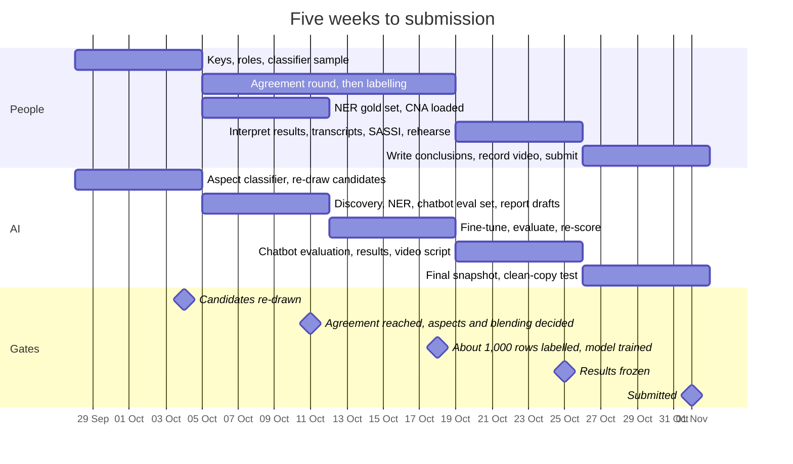

# Five weeks to submission

The plan from `docs/PLAN.md` section 5 as a timeline: what people and AI work on each week, and the gate that closes each week. For the team, and for the report's project-management section.

Rendered for the report: [SVG](img/10-plan.svg) · [PNG](img/10-plan.png)

## What this shows and doesn't show

Bars are weeks from the plan's table; they show what each week is for, not effort.
Labelling runs across two weeks because it is the critical path and its gate (about
1,000 rows) closes on 18 Oct. If it slips, the plan's fallback is to fine-tune on what is
labelled by then with k-fold cross-validation. The decisions on passing mentions, the
demo model and the OpenAI backend fall inside weeks 3 and 4 and are listed in PLAN section 2. The chart doesn't update itself: when the plan
changes, change this source too.

## Sources

Each row names the file and line an element comes from, and the text that line must contain; `check_sources.py` verifies them.

| element | source | symbol checked |
|---|---|---|
| week 1 and its gate | `docs/PLAN.md:227` | `| 28 Sep – 4 Oct | Candidates re-drawn and pre-labelled |` |
| week 2 and its gate | `docs/PLAN.md:228` | `| 5 – 11 Oct | κ ≥ 0.6 on the shared sample; blended index decided |` |
| week 3 and its gate | `docs/PLAN.md:229` | `| 12 – 18 Oct | ~1,000 rows labelled; model trained |` |
| week 4 and its gate | `docs/PLAN.md:230` | `| 19 – 25 Oct | Results frozen |` |
| week 5 and its gate | `docs/PLAN.md:231` | `| 26 Oct – 1 Nov | Submitted |` |
| submission date | `docs/PLAN.md:16` | `All due **Sunday 1 November 2026**.` |
| fallback if labelling slips | `docs/PLAN.md:233` | `If labelling slips, the fallback is to fine-tune` |
