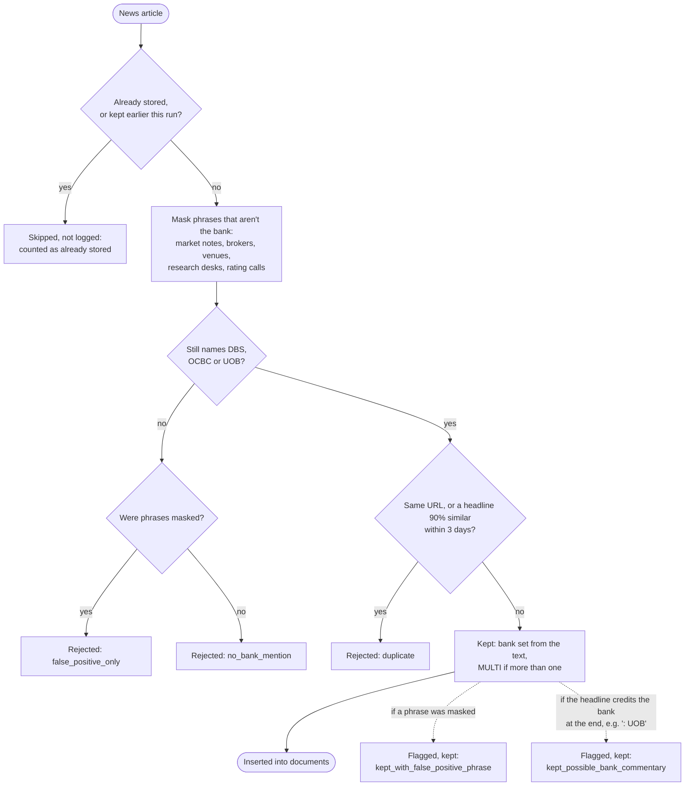

# News filter: what happens to one article

The order of decisions `ingest/news_filter.py` makes for each news article, and the reason recorded at each exit. For the report's data-cleaning section and for anyone auditing `data/news_flagged.csv`.

Rendered for the report: [SVG](img/11-news-filter.svg) · [PNG](img/11-news-filter.png)

## What this shows and doesn't show

Every exit except "skipped" writes a row to `data/news_flagged.csv` with its reason,
so nothing is dropped silently. Masking comes first so that "UOB Kay Hian upgrades DBS"
counts as a DBS article rather than being rejected or counted as UOB. Market notes (a
currency or macro headline ending in a bank's name) and rating calls are masked unless the
headline also mentions the bank's own results, an award or a launch. The two flags don't
stop an article being kept; they mark it for a person to look at. The rules are described
in full, with counts, in [../news-data.md](../news-data.md).

## Sources

Each row names the file and line an element comes from, and the text that line must contain; `check_sources.py` verifies them.

| element | source | symbol checked |
|---|---|---|
| already stored | `ingest/news_filter.py:260` | `if d["doc_id"] in index.doc_ids:` |
| mask, then find banks | `ingest/news_filter.py:263` | `banks, phrases = mentioned_banks(doc_text(` |
| masking function | `ingest/news_filter.py:137` | `def mask_false_positives(text: str)` |
| market notes masked first | `ingest/news_filter.py:143` | `found.append("market note")` |
| exemptions for the bank's own news | `ingest/news_filter.py:142` | `and not _OWN_PERFORMANCE.search(text) and not _MARKET_NOTE_EXEMPT.search(text)):` |
| brokers, venues, research, rating calls | `ingest/news_filter.py:73` | `FALSE_POSITIVES = [` |
| no bank: which reason | `ingest/news_filter.py:269` | `reason = "false_positive_only" if phrases else "no_bank_mention"` |
| duplicate check | `ingest/news_filter.py:274` | `dup = index.find_duplicate(` |
| 90% headline similarity | `ingest/news_filter.py:53` | `TITLE_SIMILARITY = 0.90` |
| within 3 days | `ingest/news_filter.py:54` | `DUP_WINDOW_DAYS = 3` |
| bank from the text, MULTI | `ingest/news_filter.py:280` | `d = {**d, "bank": banks[0] if len(banks) == 1 else "MULTI"}` |
| flag: masked phrase | `ingest/news_filter.py:284` | `"reason": "kept_with_false_positive_phrase"` |
| flag: possible commentary | `ingest/news_filter.py:287` | `"reason": "kept_possible_bank_commentary"` |
| every decision logged | `ingest/news_filter.py:292` | `_append_flagged(flagged)` |
