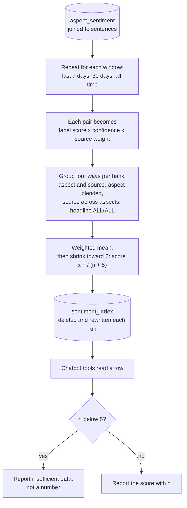

# How a sentiment index row is computed

How `aggregate/index.py` turns scored sentence–aspect pairs into the numbers the dashboard, API and chatbot show. For the report's sentiment-index section.

Rendered for the report: [SVG](img/12-index-computation.svg) · [PNG](img/12-index-computation.png)

## What this shows and doesn't show

Label scores are +1, 0 and -1. Source weights are 1.5 for news sources and 1.0 for
Reddit and earnings (earnings was reduced from 3.0; DESIGN decision 6). Shrinkage pulls a
score based on few sentences toward neutral, and every row stores `n` so a reader can see
the sample size. The volume floor is not applied when rows are computed: the chatbot's
tools apply it when reading, and the dashboard shows `n` beside each score instead. The
continuous time series (`compute_time_series`) uses the same summarising function, so a
chart can't disagree with the headline number. It applies its own floor: a bucket with fewer than 5 sentences is marked
`sufficient=False`, and the dashboard leaves it off the line and says how many it omitted.

## Sources

Each row names the file and line an element comes from, and the text that line must contain; `check_sources.py` verifies them.

| element | source | symbol checked |
|---|---|---|
| read every scored pair | `aggregate/index.py:100` | `FROM aspect_sentiment ase` |
| joined to sentences | `aggregate/index.py:101` | `JOIN sentences sa ON sa.sentence_id = ase.sentence_id` |
| windows | `aggregate/index.py:65` | `WINDOWS = {"7d": 7, "30d": 30, "all_time": None}` |
| window cutoff | `aggregate/index.py:196` | `if cutoff is not None and published_at < cutoff:` |
| label scores | `aggregate/index.py:49` | `_LABEL_SCORE = {"positive": 1.0, "neutral": 0.0, "negative": -1.0}` |
| source weights | `aggregate/index.py:62` | `_SOURCE_WEIGHT = {"earnings": 1.0` |
| each item weighted | `aggregate/index.py:198` | `item = (label, confidence, _SOURCE_WEIGHT.get(source, 1.0))` |
| group: aspect and source | `aggregate/index.py:199` | `groups[(bank, aspect, source, model_version)].append(item)` |
| group: headline | `aggregate/index.py:202` | `groups[(bank, "ALL", SOURCE_ALL, model_version)].append(item)` |
| weighted mean | `aggregate/index.py:112` | `raw_score = weighted_sum / weight_total` |
| shrinkage | `aggregate/index.py:113` | `shrunk = raw_score * (n / (n + SHRINKAGE_K))` |
| shrinkage constant | `aggregate/index.py:48` | `SHRINKAGE_K = 5` |
| deleted and rewritten | `aggregate/index.py:236` | `conn.execute("DELETE FROM sentiment_index")` |
| volume floor, applied when read | `chatbot/tools.py:22` | `MIN_VOLUME_FOR_SCORE = 5` |
| time-series floor | `aggregate/index.py:129` | `min_n: int = 5` |
| thin buckets left off the chart | `dashboard/app.py:277` | `plotted = series[series.sufficient]` |
| insufficient data reported | `chatbot/tools.py:87` | `if n < MIN_VOLUME_FOR_SCORE:` |
