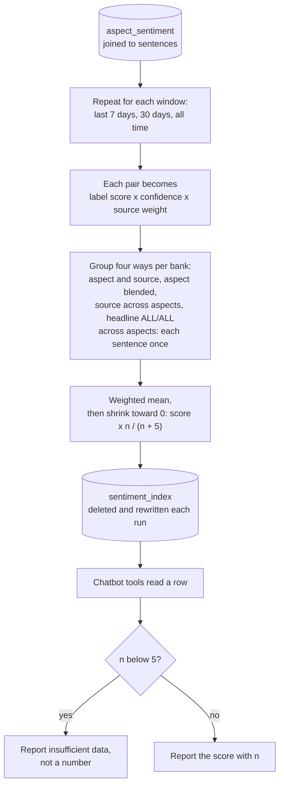

# How a sentiment index row is computed

How `aggregate/index.py` turns scored sentence–aspect pairs into the numbers the API and chatbot serve. For the report's sentiment-index section.

Rendered for the report: [SVG](img/12-index-computation.svg) · [PNG](img/12-index-computation.png)

## What this shows and doesn't show

Label scores are +1, 0 and -1. Source weights are 1.5 for news sources and 1.0 for
Reddit and earnings (earnings was reduced from 3.0; DESIGN decision 6). Shrinkage pulls a
score based on few sentences toward neutral, and every row stores `n` so a reader can see
the sample size. A sentence matched to several aspects has a pair per aspect; the per-aspect
rows count each pair, but the rows spanning aspects (each source's ALL row and the headline)
count the sentence once, using its most confident pair. Before 2026-09-30 they counted every
pair, which weighted sentences by how many aspects they matched. The volume floor is not applied when rows are computed: the chatbot's
tools apply it when reading, and the API returns `n` beside each score for a dashboard to show. The
continuous time series (`compute_time_series`) uses the same summarising function, so a
chart can't disagree with the headline number. It applies its own floor: a bucket with fewer than 5 sentences is marked
`sufficient=False`, and a chart should leave it off the line ([api-integration.md](../api-integration.md)).

## Sources

Each row names the file and line an element comes from, and the text that line must contain; `check_sources.py` verifies them.

| element | source | symbol checked |
|---|---|---|
| read every scored pair | `aggregate/index.py:98` | `FROM aspect_sentiment ase` |
| joined to sentences | `aggregate/index.py:99` | `JOIN sentences sa ON sa.sentence_id = ase.sentence_id` |
| windows | `aggregate/index.py:61` | `WINDOWS = {"7d": 7, "30d": 30, "all_time": None}` |
| window cutoff | `aggregate/index.py:245` | `if t is None or t < cutoff:` |
| label scores | `aggregate/index.py:45` | `_LABEL_SCORE = {"positive": 1.0, "neutral": 0.0, "negative": -1.0}` |
| source weights | `aggregate/index.py:58` | `_SOURCE_WEIGHT = {"earnings": 1.0` |
| each item weighted | `aggregate/index.py:247` | `item = (label, confidence, _SOURCE_WEIGHT.get(source, 1.0))` |
| group: aspect and source | `aggregate/index.py:248` | `groups[(bank, aspect, source, model_version)].append(item)` |
| group: headline, once per sentence | `aggregate/index.py:251` | `_one_per_sentence(across_aspects, sentence_id, (bank, "ALL", SOURCE_ALL, model_version), item)` |
| keep the most confident pair | `aggregate/index.py:116` | `if current is None or item[1] > current[1]:` |
| weighted mean | `aggregate/index.py:127` | `raw_score = weighted_sum / weight_total` |
| shrinkage | `aggregate/index.py:128` | `shrunk = raw_score * (n / (n + SHRINKAGE_K))` |
| shrinkage constant | `aggregate/index.py:44` | `SHRINKAGE_K = 5` |
| deleted and rewritten | `aggregate/index.py:287` | `conn.execute("DELETE FROM sentiment_index")` |
| volume floor, applied when read | `chatbot/tools.py:27` | `MIN_VOLUME_FOR_SCORE = 5` |
| time-series floor | `aggregate/index.py:163` | `min_n: int = 5` |
| thin buckets left off the chart | `docs/api-integration.md:85` | `gap, not a line through them, and not a zero.` |
| insufficient data reported | `chatbot/tools.py:114` | `if n < MIN_VOLUME_FOR_SCORE:` |
