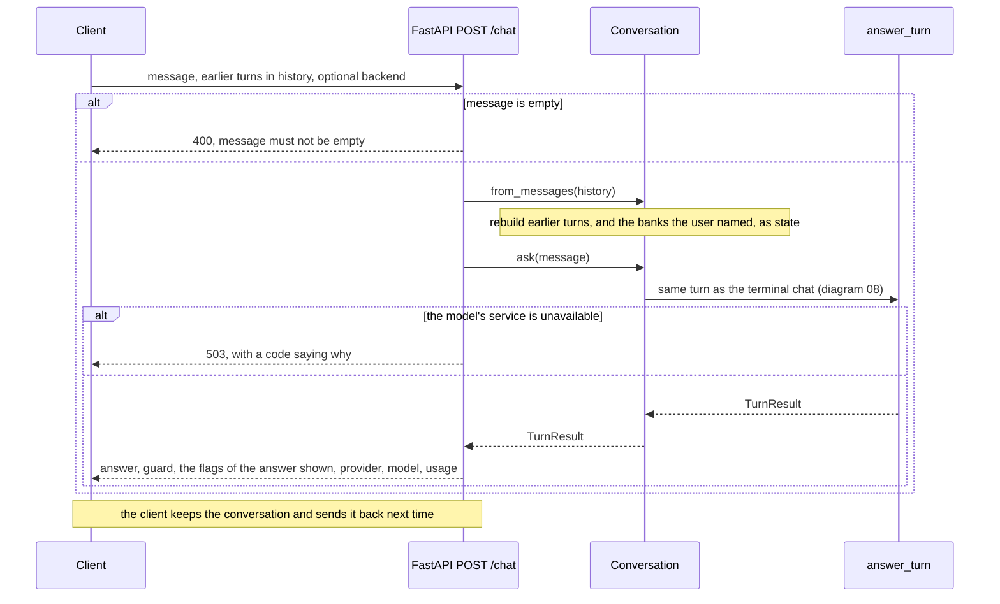

# Chatbot through the REST API

How a client holds a conversation through `POST /chat`, given that the API keeps no state between requests. For anyone building a front end on the API.

Rendered for the report: [SVG](img/13-api-chat.svg) · [PNG](img/13-api-chat.png)

## What this shows and doesn't show

The API is stateless: each request carries the conversation so far, and nothing is
stored on the server. A conversation rebuilt from plain messages doesn't know which tools
earlier turns called, so its state holds only the banks the user named; the terminal chat,
which keeps its `Conversation` object, also has the aspect from earlier tool calls. The
flags in the response are those of the answer shown: empty when the answer was checked,
and if need be rewritten or trimmed, before it was returned (`CHATBOT_VERIFY_BEFORE_REPLY`,
on by default). `provider`, `model` and `usage` name the service that answered and its
token counts; a fixed reply has none. When the model's service can't be reached or its
daily budget is spent, the API answers 503 with a code saying which.

## Sources

Each row names the file and line an element comes from, and the text that line must contain; `check_sources.py` verifies them.

| element | source | symbol checked |
|---|---|---|
| POST /chat | `api/main.py:396` | `@app.post("/chat",` |
| request carries history | `api/main.py:393` | `history: list[ChatMessage] = []` |
| empty message rejected | `api/main.py:399` | `detail="message must not be empty"` |
| rebuild from messages | `api/main.py:400` | `conv = Conversation.from_messages(` |
| one turn | `api/main.py:402` | `turn = conv.ask(req.message)` |
| response fields | `api/main.py:411` | `return {"question": req.message, "answer": turn.answer, "guard": turn.guard,` |
| the flags of the answer shown | `api/main.py:412` | `**turn.shown_flags(), **metadata}` |
| 503 when the model is unavailable | `api/main.py:406` | `raise HTTPException(status_code=503, detail=_chat_problem(code).model_dump()) from e` |
| state from banks named | `chatbot/agent.py:2470` | `def from_messages(cls, messages: list[dict]` |
