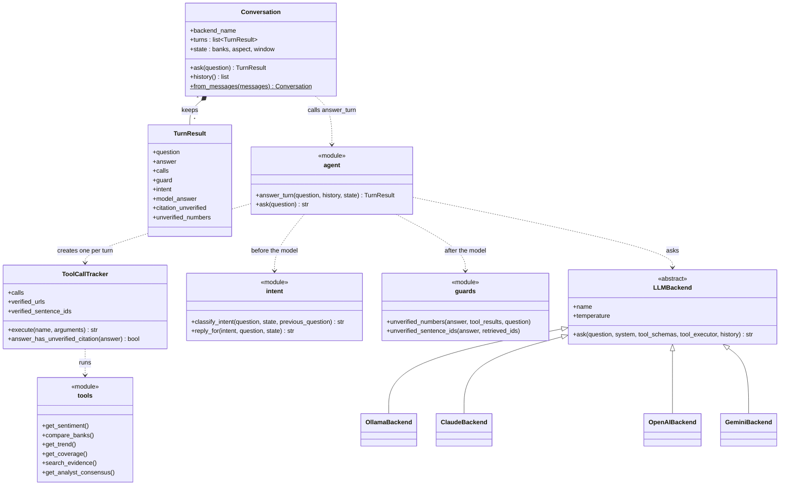

# Chatbot components

The classes and modules behind a chatbot turn and how they depend on each other. For a developer changing the chatbot or adding a model backend.

Rendered for the report: [SVG](img/14-chatbot-components.svg) · [PNG](img/14-chatbot-components.png)

## What this shows and doesn't show

Everything here is built. The dotted arrows are UML "uses" dependencies, not planned
parts; solid arrows with hollow heads are inheritance, and the filled diamond means a
`Conversation` owns its turns. Modules without a class of their own (`chatbot/agent.py`'s functions,
`intent`, `guards`, `tools`) are drawn as classes marked `module`. The tracker is `_ToolCallTracker` in the
code; the leading underscore is dropped here because Mermaid would render it oddly. Only
the members a turn uses are listed. Each backend owns its whole tool-calling loop,
because providers represent tool calls differently (`chatbot/backends/base.py`).

## Sources

Each row names the file and line an element comes from, and the text that line must contain; `check_sources.py` verifies them.

| element | source | symbol checked |
|---|---|---|
| Conversation | `chatbot/agent.py:1617` | `class Conversation:` |
| state fields | `chatbot/agent.py:1623` | `self.state: dict = {"banks": [], "aspect": None, "window": None}` |
| from_messages | `chatbot/agent.py:1627` | `def from_messages(cls, messages: list[dict]` |
| TurnResult | `chatbot/agent.py:1519` | `class TurnResult:` |
| answer_turn | `chatbot/agent.py:1532` | `def answer_turn(question: str` |
| ToolCallTracker | `chatbot/agent.py:647` | `class _ToolCallTracker:` |
| citation check | `chatbot/agent.py:807` | `def answer_has_unverified_citation(self, answer: str)` |
| intent | `chatbot/intent.py:106` | `def classify_intent(question: str` |
| reply_for | `chatbot/intent.py:125` | `def reply_for(intent` |
| guards | `chatbot/guards.py:314` | `def unverified_numbers(answer: str, tool_results: list, question: str = "")` |
| intent and model_answer kept | `chatbot/agent.py:1525` | `intent: str` |
| tools | `chatbot/tools.py:646` | `TOOL_FUNCTIONS = {` |
| LLMBackend | `chatbot/backends/base.py:36` | `class LLMBackend(ABC):` |
| temperature | `chatbot/backends/base.py:42` | `temperature: float = DEFAULT_TEMPERATURE` |
| OllamaBackend | `chatbot/backends/ollama_backend.py:45` | `class OllamaBackend(LLMBackend):` |
| ClaudeBackend | `chatbot/backends/claude_backend.py:23` | `class ClaudeBackend(LLMBackend):` |
| OpenAIBackend | `chatbot/backends/openai_backend.py:54` | `class OpenAIBackend(LLMBackend):` |
| GeminiBackend | `chatbot/backends/gemini_backend.py:83` | `class GeminiBackend(LLMBackend):` |
