# Conversation state across turns

How the chatbot's record of what the conversation is about (banks, aspect, window) is set and used. For anyone debugging why a follow-up question was or wasn't understood.

```mermaid
stateDiagram-v2
  accTitle: Conversation state
  accDescr: A new conversation has no context. Each turn updates it from tool calls or from a bank named in a guard-answered question; the state is added to the next turn's system prompt. Window is never set today.

  [*] --> NoContext : new conversation
  NoContext --> HasContext : a turn names a bank
  HasContext --> HasContext : each turn updates it
  HasContext --> [*] : Clear conversation
  NoContext --> [*] : Clear conversation

  note left of HasContext
    How a turn updates it:
    a tool call with a bank sets banks and aspect,
    compare_banks sets all three banks,
    a guard-answered question naming a bank sets banks.
    The latest turn wins.
  end note
  note right of HasContext
    Added to the next turn's system prompt,
    so "and OCBC?" keeps the aspect.
    window stays empty: no tool
    takes a window argument today.
  end note
```

Rendered for the report: [SVG](img/15-conversation-state.svg) · [PNG](img/15-conversation-state.png)

## What this shows and doesn't show

The state names (NoContext, HasContext) describe the situation; the code has no such
enum. The state is a small dictionary: `banks`, `aspect` (empty means overall) and `window`.
It is overwritten, not accumulated: the latest tool call wins. **Doc/code disagreement:**
DESIGN decision 19 says the state tracks the time window, but none of the six tool schemas
exposes a window argument (`get_sentiment` accepts one in Python, but the model is never
offered it), so `window` is never set. The dashboard's "Clear conversation" button starts a
new `Conversation`; the API rebuilds state on every request from the banks the user named
([13](13-api-chat.md)).

## Sources

Each row names the file and line an element comes from, and the text that line must contain; `check_sources.py` verifies them.

| element | source | symbol checked |
|---|---|---|
| new conversation, empty state | `chatbot/agent.py:214` | `self.state: dict = {"banks": [], "aspect": None, "window": None}` |
| compare_banks sets all three | `chatbot/agent.py:245` | `if c["name"] == "compare_banks":` |
| a tool call names a bank | `chatbot/agent.py:247` | `elif args.get("bank"):` |
| window only if a tool passes one | `chatbot/agent.py:251` | `if args.get("window"):` |
| guard-answered question names a bank | `chatbot/agent.py:253` | `if not r.calls:` |
| state into the system prompt | `chatbot/agent.py:169` | `with_state(SYSTEM_PROMPT, state)` |
| no window in get_sentiment's schema | `chatbot/tools.py:255` | `"required": ["bank"],` |
| get_sentiment accepts a window in Python | `chatbot/tools.py:61` | `def get_sentiment(bank: str, aspect: str | None = None, window: str = "all_time")` |
| Clear conversation | `dashboard/app.py:370` | `st.session_state.conversation = Conversation()` |
| DESIGN claims the window is tracked | `docs/DESIGN.md:340` | `tracks the current bank, aspect and time window` |
