# One candidate row in the first labelling round

The states a labelling candidate went through in the 2026-09-27 round, from export to training or the test set. For annotators, and for the report's annotation-methodology section.

```mermaid
stateDiagram-v2
  accTitle: Label lifecycle, first round
  accDescr: A candidate is exported into the train/dev or test split. Train/dev rows carry an LLM suggestion; test rows go to a blind sheet. Two people label each row and disagreements are resolved. Duplicated or leaked rows are dropped; the rest train the model or form the test set. A not-about-the-bank flag is planned.

  [*] --> Exported : drawn from the scored sample
  Exported --> Suggested : train/dev split
  Exported --> Blind : test split
  Suggested --> Labelled : two people set aspect and sentiment
  Blind --> Labelled : same, no model output shown
  Labelled --> NotAboutBank : flagged
  Labelled --> Resolved : disagreements settled
  Resolved --> Dropped : duplicate, or leaked into test
  Resolved --> Training : train/dev row
  Resolved --> HeldOut : test row
  NotAboutBank --> [*]
  Dropped --> [*]
  Training --> [*]
  HeldOut --> [*]

  classDef planned stroke-dasharray: 5 5,color:#555,fill:#fafafa
  class NotAboutBank planned
```

Rendered for the report: [SVG](img/16-label-lifecycle.svg) · [PNG](img/16-label-lifecycle.png)

## What this shows and doesn't show

The state names are descriptive, not code. The split is fixed when a row is exported and
never changes. In this round the aspect was corrected once and shared by both annotators,
so only sentiment went through two independent labels, and the blind test labels turned out
identical to the same annotators' labels made with the suggestion visible. "Dropped" is
`train/labels.py`: 5 train/dev copies of test sentences, then 18 duplicate rows. The
not-about-the-bank flag (dashed) was in the design but not in this round's sheet.

## Sources

Each row names the file and line an element comes from, and the text that line must contain; `check_sources.py` verifies them.

| element | source | symbol checked |
|---|---|---|
| drawn from the scored sample | `notebooks/README.md:17` | `Candidates were stratified within that sample` |
| suggestions on train/dev only | `docs/PLAN.md:223` | `The local LLM's suggestions are shown for the train/dev` |
| blind sheet | `preprocess/export_blind_test.py:104` | `def export_blind(` |
| two annotators | `docs/evidence/annotation-agreement-2026-09-27.md:14` | `each annotator's labels on the 1,300 candidates` |
| resolved | `docs/evidence/annotation-agreement-2026-09-27.md:16` | `the candidates after resolving disagreements` |
| dropped: leakage | `train/labels.py:152` | `report["train_dev_rows_dropped_as_leaked"] = int(leaked.sum())` |
| dropped: duplicates | `train/labels.py:155` | `cand, report["duplicate_rows_dropped"] = _dedupe(cand, candidates_path)` |
| training rows | `train/finetune.py:176` | `df = df[df["split"] == split]` |
| held-out test rows | `train/evaluate.py:40` | `df = df[(df["split"] == "test") & (df["label"].isin(LABELS))]` |
| not-about-bank flag | `docs/annotation-guideline.md:18` | `` set `not_about_bank` and stop `` |

## Planned elements

| element | recorded in |
|---|---|
| Not-about-the-bank flag | docs/annotation-guideline.md; PLAN.md section 6 |
