# One candidate row under version 2 (planned)

The states a labelling candidate goes through under the planned version 2 design. For annotators, and for the report's annotation-methodology section.

```mermaid
stateDiagram-v2
  accTitle: Label lifecycle, planned
  accDescr: Planned. A candidate is drawn into the train/dev or test split. Train/dev rows get an LLM suggestion; test rows go to a blind sheet. A person labels aspect and sentiment or flags the row. Some rows form the agreement sample. Labelled train/dev rows train the model; test rows only evaluate it.

  [*] --> Drawn : re-drawn after the aspect classifier runs
  Drawn --> Suggested : train/dev split
  Drawn --> Blind : test split
  Suggested --> WithAnnotator : model suggestion shown
  Blind --> WithAnnotator : no model output shown
  WithAnnotator --> NotAboutBank : flagged
  WithAnnotator --> Labelled : aspect and sentiment set
  Labelled --> AgreementSample : in the shared 150 rows
  AgreementSample --> Labelled : kappa at least 0.6
  Labelled --> Training : train/dev row
  Labelled --> HeldOut : test row
  NotAboutBank --> [*]
  Training --> [*]
  HeldOut --> [*]

  classDef planned stroke-dasharray: 5 5,color:#555,fill:#fafafa
  class Drawn,Suggested,Blind,WithAnnotator,Labelled,NotAboutBank,AgreementSample,Training,HeldOut planned
```

Rendered for the report: [SVG](img/16-label-lifecycle.svg) · [PNG](img/16-label-lifecycle.png)

## What this shows and doesn't show

**Everything here is planned** (DESIGN decisions 16 and 17, PLAN section 6); it is
drawn dashed throughout. The version 1 sheet exists but won't be labelled. The split is
fixed when the row is drawn and never changes: test rows are sampled at random before any
model screening and only ever evaluate the model. If the agreement sample falls below
0.6, the guideline is tightened and the sample relabelled before the rest is split up.

## Sources

Each row names the file and line an element comes from, and the text that line must contain; `check_sources.py` verifies them.

| element | source | symbol checked |
|---|---|---|
| aspect and sentiment per sentence | `docs/PLAN.md:38` | `**Annotators record aspect and sentiment for each sentence**` |
| test drawn at random, blind sheet | `docs/PLAN.md:149` | `labelled only from the blind sheet` |
| suggestions on train/dev only | `docs/PLAN.md:150` | `The local LLM's suggestions are shown for the train/dev` |
| 150-row agreement sample | `docs/PLAN.md:152` | `Two people label the same 150 rows first` |
| not-about-bank flag | `docs/annotation-guideline.md:16` | `set `not_about_bank` and stop` |
| don't label version 1 | `docs/annotation-guideline.md:7` | `don't label the current` |

## Planned elements

| element | recorded in |
|---|---|
| every state | DESIGN.md decisions 16 and 17; PLAN.md section 6 |
