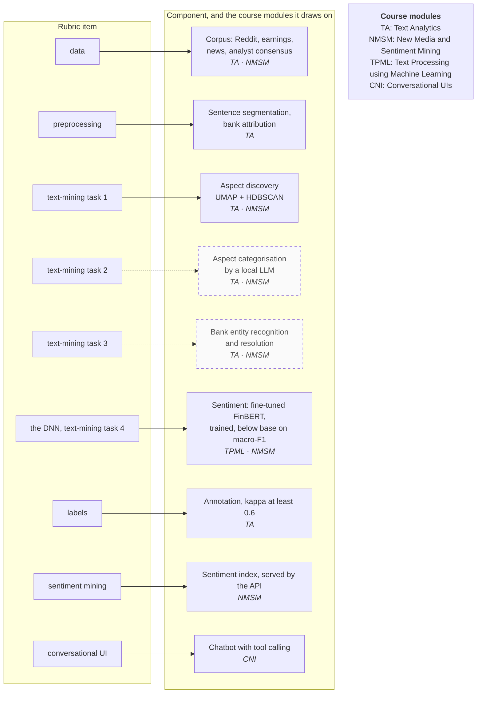

# What each rubric item rests on

Each rubric item, the component that answers it, and the course module that component draws on, from `docs/PLAN.md` section 3. For the report's solution-approach section.

**Legend.** Solid shapes and arrows are built and running. Dashed shapes and arrows labelled *planned* are decided but not yet built, with the DESIGN.md decision that records them. Shapes marked *not installed* exist in the repository but aren't running anywhere.

Rendered for the report: [SVG](img/17-rubric-map.svg) · [PNG](img/17-rubric-map.png)

## What this shows and doesn't show

One rubric item maps to one component. The modules each component draws on are
written inside it rather than drawn as arrows, because fourteen crossing arrows into four
boxes were unreadable. Two components are planned (dashed): the LLM aspect classifier and
bank entity recognition. The first annotation round is done (1,277 rows, sentiment kappa
0.93), and the fine-tuned sentiment model trained on it scores macro-F1 0.547 against base
FinBERT's 0.571, so base FinBERT zero-shot still scores the corpus. Aspect discovery is built and was run once to derive the taxonomy; PLAN
section 5 schedules a re-run. Not shown: the day-level course references and the
evaluation for each component, which are in the PLAN table this is drawn from.

## Sources

Each row names the file and line an element comes from, and the text that line must contain; `check_sources.py` verifies them.

| element | source | symbol checked |
|---|---|---|
| data: corpus | `docs/PLAN.md:122` | `| Corpus: Reddit, earnings PDFs, news, analyst consensus | data |` |
| preprocessing | `docs/PLAN.md:123` | `| Sentence segmentation, bank attribution | preprocessing |` |
| task 3: bank NER | `docs/PLAN.md:124` | `| **Bank entity recognition and resolution** | text-mining task 3 |` |
| task 1: aspect discovery | `docs/PLAN.md:125` | `| **Aspect discovery** (FinBERT embeddings → UMAP → HDBSCAN) | text-mining task 1 |` |
| task 2: aspect categorisation | `docs/PLAN.md:126` | `| **Aspect categorisation** (local LLM, fixed schema) | text-mining task 2 |` |
| DNN, task 4: sentiment | `docs/PLAN.md:127` | `| **Sentiment classification** (fine-tuned FinBERT) | the DNN; text-mining task 4 |` |
| labels: annotation | `docs/PLAN.md:128` | `| Annotation | labels |` |
| sentiment mining: index, served by the API | `docs/PLAN.md:129` | `| Sentiment index, served by the API | sentiment mining |` |
| conversational UI: chatbot | `docs/PLAN.md:130` | `| **Chatbot** (tool calling over the index and evidence) | conversational UI |` |
| module abbreviations | `docs/PLAN.md:132` | `Course modules: TA = Text Analytics, NMSM = New Media and Sentiment Mining,` |
| aspect discovery is built | `aspects/discover.py:49` | `def run(min_cluster_size: int = 10)` |
| segmentation is built | `preprocess/segment.py:62` | `def segment(text: str)` |
| fine-tuning is built | `train/finetune.py:267` | `def run(seed: int = 42` |
| the fine-tuned model scores today | `docs/api-integration.md:177` | `**Scores come from the fine-tuned model**` |
| annotation done | `docs/evidence/annotation-agreement-2026-09-27.md:34` | `| candidates, both splits | 1,277 | 0.952 | **0.926** |` |
| fine-tuned, below base | `docs/evidence/finetune-2026-09-30.md:28` | `| fine-tuned FinBERT, 3 seeds |` |

## Planned elements

| element | recorded in |
|---|---|
| Aspect categorisation by a local LLM | DESIGN.md decision 16; PLAN.md section 2 |
| Bank entity recognition and resolution | DESIGN.md decision 18; PLAN.md sections 2 and 7 |
