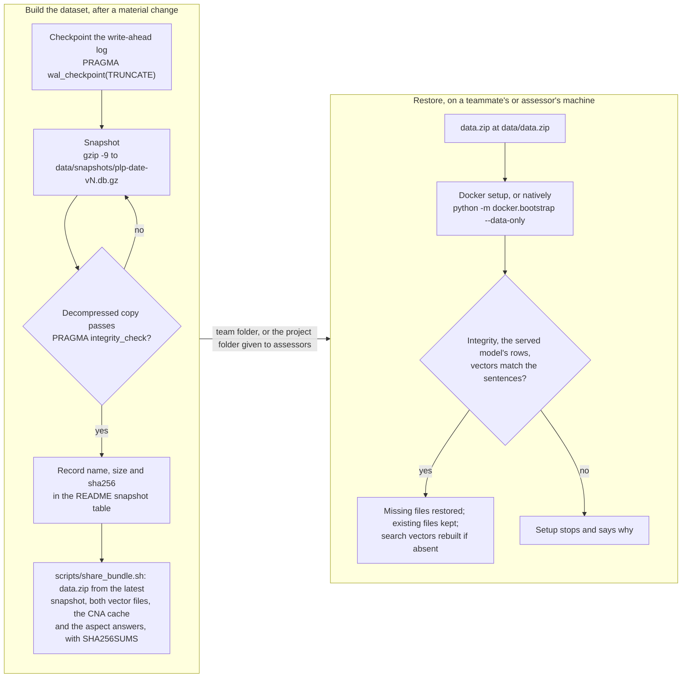

# Sharing the dataset as data.zip

How `data/plp.db` and the files that go with it reach a teammate or an assessor without going through git: the RUNBOOK steps to make a snapshot, the script that builds `data.zip` from it, and the setup that restores it. For the team.

**Legend.** Solid shapes and arrows are built and running. Dashed shapes and arrows labelled *planned* are decided but not yet built, with the DESIGN.md decision that records them. Shapes marked *not installed* exist in the repository but aren't running anywhere.

Rendered for the report: [SVG](img/18-snapshots.svg) · [PNG](img/18-snapshots.png)

## What this shows and doesn't show

The database (101.4 MB decompressed) is too large for GitHub and holds CNA articles and
Reddit text, so it lives outside git as dated, compressed snapshots (DESIGN decision 15).
The dataset everyone receives is `data.zip`: the latest snapshot decompressed, both vector
files, the CNA cache and the aspect model's answers, in the layout the Docker setup
restores. Checkpointing first matters: without it, recent writes can sit in the `-wal` file
and be missing from the snapshot. Nothing automates the upload: the team folder and the
project folder given to the assessors are outside the repository. Setup restores only
missing files and never overwrites one, so replacing a database means moving the old one
aside first. The "no" branch on the left is what a person does on a failed check; the one
on the right is the setup's own refusal, which names the problem. Setup also checks
`data.zip` against `PLP_DATA_SHA256` when that is set.

## Sources

Each row names the file and line an element comes from, and the text that line must contain; `check_sources.py` verifies them.

| element | source | symbol checked |
|---|---|---|
| checkpoint | `docs/RUNBOOK.md:539` | `sqlite3 data/plp.db "PRAGMA wal_checkpoint(TRUNCATE);"` |
| compress | `docs/RUNBOOK.md:540` | `gzip -9 -c data/plp.db > data/snapshots/plp-<date>-vN.db.gz` |
| verify | `docs/RUNBOOK.md:541` | `sqlite3 /tmp/check.db "PRAGMA integrity_check;"` |
| record checksum in the README | `docs/RUNBOOK.md:542` | `# record name, size and checksum in the README` |
| after a material change | `docs/RUNBOOK.md:536` | `### Snapshot the database after a material change` |
| snapshot table | `README.md:319` | `| snapshot | size | sha256 | contents |` |
| from the latest snapshot | `scripts/share_bundle.sh:28` | `snapshot="$(ls -1 "$ROOT"/data/snapshots/plp-*.db.gz 2>/dev/null` |
| build data.zip | `scripts/share_bundle.sh:52` | `z.write(db, "data/plp.db")` |
| checksum file | `scripts/share_bundle.sh:58` | `shasum -a 256 data.zip > SHA256SUMS` |
| at data/data.zip | `README.md:296` | `` ours to publish. Put it at `data/data.zip`. Docker restores it on first start `` |
| native restore | `README.md:301` | `.venv-plp/bin/python3 -m docker.bootstrap --data-only` |
| Docker runs the setup | `compose.yaml:46` | `command: ["python", "-m", "docker.bootstrap"]` |
| the files restored | `docker/bootstrap.py:26` | `RUNTIME_FILES = {"plp.db", "sentence_embeddings.npz", "search_embeddings.npz", "cna/articles.jsonl", "cna/candidates.json"}` |
| integrity | `docker/bootstrap.py:106` | `if conn.execute("PRAGMA quick_check").fetchone()[0] != "ok":` |
| the served model's rows | `docker/bootstrap.py:111` | `found = conn.execute(f"SELECT 1 FROM {table} WHERE model_version=? LIMIT 1", (model_version,)).fetchone()` |
| vectors match the sentences | `docker/bootstrap.py:119` | `def validate_embeddings(` |
| existing files kept | `docker/bootstrap.py:138` | `def publish_missing(source: Path, destination: Path) -> bool:` |
| checksum at setup | `docker/bootstrap.py:51` | `raise SetupError("data/data.zip failed SHA-256 verification. Obtain the supplied bundle again.")` |
| decision | `docs/DESIGN.md:315` | `### 15. The database lives outside git, as dated snapshots` |
