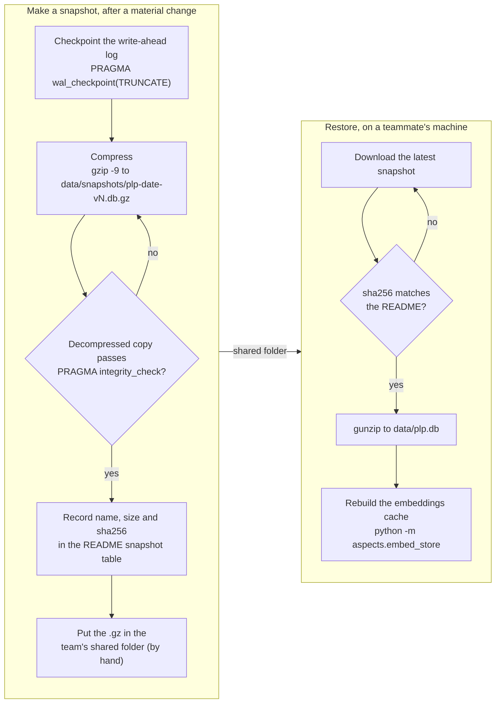

# Sharing the database as snapshots

How `data/plp.db` reaches a teammate without going through git: the RUNBOOK steps to make a snapshot and the README steps to restore one. For the team.

**Legend.** Solid shapes and arrows are built and running. Dashed shapes and arrows labelled *planned* are decided but not yet built, with the DESIGN.md decision that records them. Shapes marked *not installed* exist in the repository but aren't running anywhere.

Rendered for the report: [SVG](img/18-snapshots.svg) · [PNG](img/18-snapshots.png)

## What this shows and doesn't show

The database (198.5 MB restored) is too large for GitHub, so it lives outside git as dated,
compressed snapshots (DESIGN decision 15); the latest, `plp-2026-09-30.db.gz`, is the
frozen corpus (PLAN D5), with CNA and the 10-aspect taxonomy. Checkpointing first matters: without it, recent writes can sit
in the `-wal` file and be missing from the copy. Nothing automates the upload or the
download; the shared folder is outside the repository. The "no" branches are what a
person should do on a failed check, not steps any script performs. The embeddings cache
`data/sentence_embeddings.npz` isn't shared, because it can be rebuilt from the database.
In the README the checksum is run on the `.gz` after decompressing it; the order doesn't
matter, because the check is on the downloaded file.

## Sources

Each row names the file and line an element comes from, and the text that line must contain; `check_sources.py` verifies them.

| element | source | symbol checked |
|---|---|---|
| checkpoint | `docs/RUNBOOK.md:179` | `sqlite3 data/plp.db "PRAGMA wal_checkpoint(TRUNCATE);"` |
| compress | `docs/RUNBOOK.md:180` | `gzip -9 -c data/plp.db > data/snapshots/plp-<date>-vN.db.gz` |
| verify | `docs/RUNBOOK.md:181` | `sqlite3 /tmp/check.db "PRAGMA integrity_check;"` |
| record checksum in the README | `docs/RUNBOOK.md:182` | `# record name, size and checksum in the README` |
| after a material change | `docs/RUNBOOK.md:176` | `### Snapshot the database after a material change` |
| too large for git | `README.md:126` | `` `data/plp.db` (198.5 MB restored from the latest snapshot) is too large for GitHub `` |
| shared folder | `README.md:127` | `Download the latest snapshot from the team's shared folder` |
| decompress | `README.md:130` | `gunzip -c plp-2026-09-30.db.gz > data/plp.db` |
| compare checksum | `README.md:131` | `# should match the checksum below` |
| snapshot table | `README.md:134` | `| snapshot | size | sha256 | contents |` |
| embeddings rebuilt, not shared | `README.md:143` | `` `python -m aspects.embed_store` rebuilds from the database `` |
| decision | `docs/DESIGN.md:284` | `### 15. The database lives outside git, as dated snapshots` |
