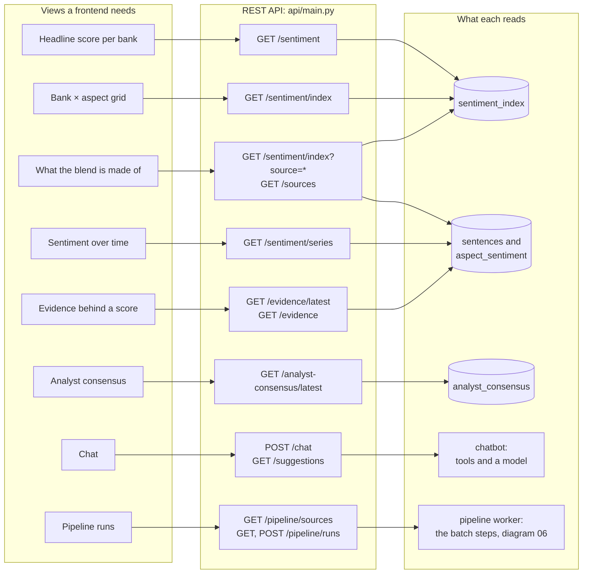

# The API behind a dashboard

Which endpoint feeds each view a dashboard needs, and what each endpoint reads. The Streamlit dashboard in this repository (`dashboard/`, a teammate's) reads only through the API (`dashboard/api_client.py`); this is the contract it and any other frontend build on (DESIGN decision 23). For the report's system-design section.

**Legend.** Solid shapes and arrows are built and running. Dashed shapes and arrows labelled *planned* are decided but not yet built, with the DESIGN.md decision that records them. Shapes marked *not installed* exist in the repository but aren't running anywhere.

Rendered for the report: [SVG](img/19-api-for-a-dashboard.svg) · [PNG](img/19-api-for-a-dashboard.png)

## What this shows and doesn't show

Every view reads one or two endpoints, and every endpoint is read-only except
`POST /chat`, which only calls a model, and `POST /pipeline/runs`, which starts the batch
steps in a worker. The headline and the grid come from the stored
index; the time series is computed from the scored sentences on each request, with the
same weighting, so a chart can't disagree with the headline. The dashboard in this repository uses
`/sentiment/index`, `/sentiment/series`, `/sentiment/trend`, `/analyst-consensus/latest`,
`/evidence/latest`, `/chat`, `/chat/status`, `/suggestions` and the `/pipeline` endpoints.
Not shown: `/sentiment/compare`, `/sentiment/trend`, `/coverage`, `/aspects`, `/banks` and
`/chat/status`, which a dashboard may also use, and the caveats the screen must carry. Both are in
[api-integration.md](../api-integration.md), with example responses.

## Sources

Each row names the file and line an element comes from, and the text that line must contain; `check_sources.py` verifies them.

| element | source | symbol checked |
|---|---|---|
| headline score | `api/main.py:124` | `@app.get("/sentiment")` |
| bank × aspect grid | `api/main.py:142` | `@app.get("/sentiment/index")` |
| composition: sentence counts | `api/main.py:180` | `@app.get("/sources")` |
| series computed from scored sentences | `api/main.py:270` | `@app.get("/sentiment/series")` |
| each bank's newest consensus | `api/main.py:217` | `@app.get("/analyst-consensus/latest")` |
| newest sentences for a bank and aspect | `api/main.py:237` | `@app.get("/evidence/latest")` |
| evidence search | `api/main.py:204` | `@app.get("/evidence")` |
| chat | `api/main.py:396` | `@app.post("/chat",` |
| starter questions | `api/main.py:289` | `@app.get("/suggestions")` |
| CORS open to any origin | `api/main.py:77` | `CORSMiddleware, allow_origins=["*"]` |
| the dashboard reads through the API | `dashboard/api_client.py:39` | `base_url = (os.getenv("PLP_API_URL") or default_url).rstrip("/")` |
| pipeline sources | `api/pipeline.py:136` | `@router.get("/sources", response_model=PipelineSources)` |
| pipeline runs listed | `api/pipeline.py:176` | `@router.get("/runs", response_model=PipelineHistory)` |
| the dashboard starts a run | `dashboard/pipeline_client.py:111` | `request_json("POST", "/pipeline/runs", body=body)` |
