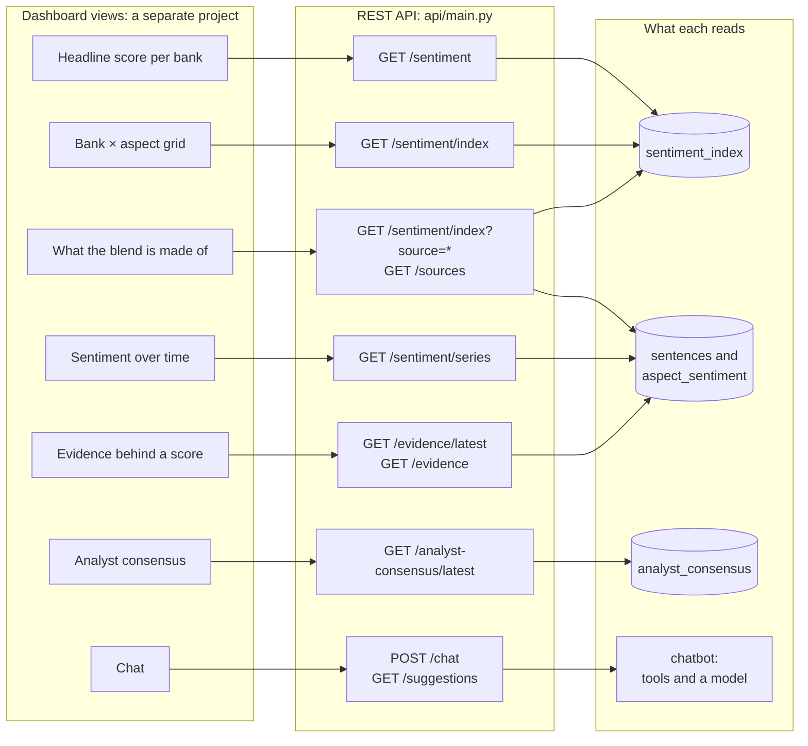

# The API behind a dashboard

Which endpoint feeds each view a dashboard needs, and what each endpoint reads. The dashboard is a separate project (DESIGN decision 23); this is its contract with this repository. For the report's system-design section and for whoever builds the dashboard.

**Legend.** Solid shapes and arrows are built and running. Dashed shapes and arrows labelled *planned* are decided but not yet built, with the DESIGN.md decision that records them. Shapes marked *not installed* exist in the repository but aren't running anywhere.

Rendered for the report: [SVG](img/19-api-for-a-dashboard.svg) · [PNG](img/19-api-for-a-dashboard.png)

## What this shows and doesn't show

Every view reads one or two endpoints, and every endpoint is read-only except
`POST /chat`, which only calls a model. The headline and the grid come from the stored
index; the time series is computed from the scored sentences on each request, with the
same weighting, so a chart can't disagree with the headline. Not shown: `/sentiment/compare`,
`/sentiment/trend`, `/coverage`, `/aspects` and `/banks`, which a dashboard may also use,
and the caveats the screen must carry. Both are in
[api-integration.md](../api-integration.md), with example responses.

## Sources

Each row names the file and line an element comes from, and the text that line must contain; `check_sources.py` verifies them.

| element | source | symbol checked |
|---|---|---|
| headline score | `api/main.py:61` | `@app.get("/sentiment")` |
| bank × aspect grid | `api/main.py:79` | `@app.get("/sentiment/index")` |
| composition: sentence counts | `api/main.py:109` | `@app.get("/sources")` |
| series computed from scored sentences | `api/main.py:199` | `@app.get("/sentiment/series")` |
| each bank's newest consensus | `api/main.py:146` | `@app.get("/analyst-consensus/latest")` |
| newest sentences for a bank and aspect | `api/main.py:164` | `@app.get("/evidence/latest")` |
| semantic evidence search | `api/main.py:134` | `@app.get("/evidence")` |
| chat | `api/main.py:247` | `@app.post("/chat")` |
| starter questions | `api/main.py:221` | `@app.get("/suggestions")` |
| CORS open to any origin | `api/main.py:47` | `CORSMiddleware, allow_origins=["*"]` |
