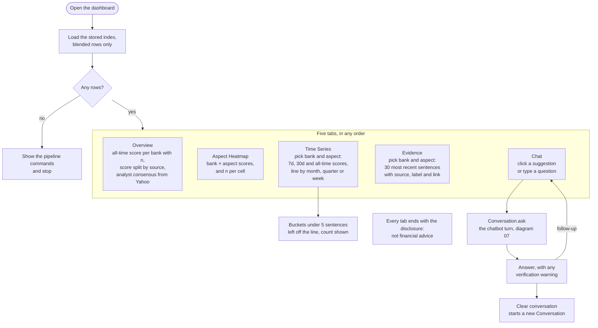

# What an investor can do in the dashboard

The five tabs of `dashboard/app.py`, what each lets a reader do, and where the Chat tab hands over to the chatbot. For the report's user-interface section.

**Legend.** Solid shapes and arrows are built and running. Dashed shapes and arrows labelled *planned* are decided but not yet built, with the DESIGN.md decision that records them. Shapes marked *not installed* exist in the repository but aren't running anywhere.

Rendered for the report: [SVG](img/19-dashboard-journey.svg) · [PNG](img/19-dashboard-journey.png)

## What this shows and doesn't show

A reader starts from headline numbers and moves to detail: the Overview's blended score,
the source split that explains it, the aspect heat map, the trend, and finally the
sentences behind a score. Each score is shown with its sentence count. Overview and
Heatmap use the all-time window; Time Series is the only tab that shows the 7-day and
30-day windows. The Chat tab keeps a `Conversation` in the session, so follow-ups carry
the bank and aspect over (diagram 15); an unreachable backend is reported in the chat
rather than crashing the page. Not shown: the colour scale's fallback when matplotlib is
missing, and the five-minute data cache. The footer text still says the news window is
about one month, which predates the backfill to 2023 (logged, not fixed, in this run).

## Sources

Each row names the file and line an element comes from, and the text that line must contain; `check_sources.py` verifies them.

| element | source | symbol checked |
|---|---|---|
| load the stored index, blended rows | `dashboard/app.py:66` | `"SELECT * FROM sentiment_index WHERE source = 'ALL'"` |
| empty: show commands and stop | `dashboard/app.py:143` | `st.warning("No sentiment data yet. Run the pipeline` |
| five tabs | `dashboard/app.py:154` | `["Overview", "Aspect Heatmap", "Time Series", "Evidence", "Chat"]` |
| Overview: per-bank score | `dashboard/app.py:157` | `st.subheader("Overall sentiment by bank (all-time)")` |
| Overview: split by source | `dashboard/app.py:170` | `st.subheader("What the blended score is made of")` |
| Overview: analyst consensus | `dashboard/app.py:193` | `st.subheader("Professional analyst consensus")` |
| Aspect Heatmap | `dashboard/app.py:225` | `st.subheader("Sentiment by bank × aspect (all-time)")` |
| Time Series: pick bank | `dashboard/app.py:249` | `ts_bank = st.selectbox("Bank", BANKS, key="ts_bank")` |
| Time Series: bucket | `dashboard/app.py:271` | `bucket = st.radio("Bucket", ["month", "quarter", "week"]` |
| thin buckets left off | `dashboard/app.py:284` | `st.caption(f"{thin} thin bucket(s) omitted from the line.")` |
| Evidence: 30 most recent | `dashboard/app.py:78` | `ORDER BY s.published_at DESC LIMIT 30` |
| Chat: suggestions | `dashboard/app.py:343` | `suggestions = get_suggestions(limit=6)` |
| Chat: typed question | `dashboard/app.py:350` | `typed = st.chat_input("Or ask your own question")` |
| Chat: Conversation.ask | `dashboard/app.py:360` | `answer = st.session_state.conversation.ask(question).answer` |
| Chat: backend unreachable | `dashboard/app.py:362` | `The chatbot backend could not be reached` |
| Clear conversation | `dashboard/app.py:370` | `st.session_state.conversation = Conversation()` |
| disclosure footer | `dashboard/app.py:129` | `f"Not financial advice — sentiment is an indicator, not a recommendation. "` |
| stale footer text | `dashboard/app.py:132` | `~1-month news window` |
