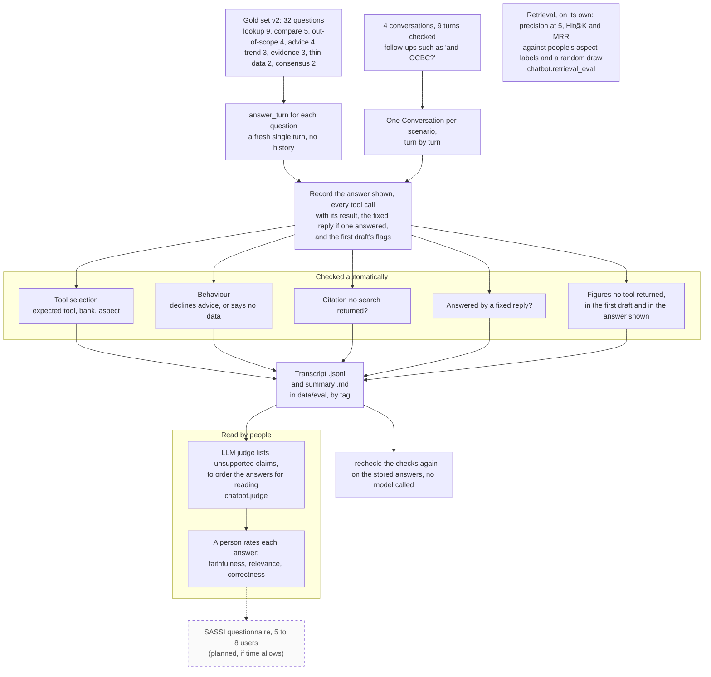

# How the chatbot is evaluated

What `chatbot/run_eval.py` does with the gold set and the conversations, which checks it automates, and what is left to people. For the report's evaluation section.

**Legend.** Solid shapes and arrows are built and running. Dashed shapes and arrows labelled *planned* are decided but not yet built, with the DESIGN.md decision that records them. Shapes marked *not installed* exist in the repository but aren't running anywhere.

Rendered for the report: [SVG](img/20-chatbot-evaluation.svg) · [PNG](img/20-chatbot-evaluation.png)

## What this shows and doesn't show

The automated checks are the ones a script can do reliably. Checking whether a number in
free text is the right number is not one of them, so the run keeps each tool call's raw
result in the transcript, and a person rated 32 answers of the local `llama3.1:8b` on faithfulness, relevance and
correctness: 7 of the 26 the model wrote state something the tool data contradicts, and
no automated check flagged them (`docs/evidence/human-ratings-2026-10-24.md`). The LLM
judge only orders the answers for that reading; it agrees with the person weakly (weighted
kappa 0.22). The figure check is a strict detector, not a grade: on the first harness run,
18 of the 19 figures it flagged were invented and one was a false alarm
(`docs/evidence/chatbot-harness-2026-09-26.md`).

A draft that fails a check is rewritten or trimmed before it is shown, so the run records
the checks' flags twice, on the model's first draft and on the answer shown; `--recheck`
fills in the second for an older results file without calling a model. On the final code,
`gpt-6-luna` chose the right tool 24 of 24 times, declined advice and admitted missing data
8 of 8 times, and showed no answer with a figure no tool returned (3 first drafts had one);
the conversations' 9 turns were all correct
(`docs/evidence/chatbot-fixes-2026-10-24.md`). The `--tag` option keeps one model's results
from overwriting another's, which is how backends were compared. The first gold set (23
questions) is still the command's default; the results reported use `--set v2`.

## Sources

Each row names the file and line an element comes from, and the text that line must contain; `check_sources.py` verifies them.

| element | source | symbol checked |
|---|---|---|
| gold set v2 | `chatbot/eval_gold_set.py:121` | `GOLD_SET_V2 = GOLD_SET + V2_ADDITIONS` |
| conversations | `chatbot/eval_gold_set.py:125` | `MULTI_TURN = [` |
| conversations run | `chatbot/run_eval.py:383` | `def run_multi_turn(` |
| fresh single turn | `chatbot/run_eval.py:182` | `turn = answer_turn(item["question"], backend_name=backend_name, verbose=False)` |
| record tool calls with results | `chatbot/run_eval.py:207` | `"result": c.get("result"), **({"by": c["by"]} if c.get("by") else {})}` |
| the answer before trimming kept | `chatbot/run_eval.py:202` | `"model_answer": (turn.model_answer if error is None else None)` |
| tool selection check | `chatbot/run_eval.py:85` | `def _check_tool_selection(item: dict, calls: list[dict])` |
| behaviour check | `chatbot/run_eval.py:107` | `def _check_behavior(item: dict, answer: str)` |
| advice decline | `chatbot/run_eval.py:111` | `if expected == "decline_advice":` |
| decline or no data | `chatbot/run_eval.py:115` | `if expected == "decline_or_no_data":` |
| citation flag | `chatbot/run_eval.py:195` | `fabricated = bool(turn.citation_unverified)` |
| fixed reply | `chatbot/run_eval.py:211` | `"input_guard": guard,` |
| figures in the answer shown | `chatbot/run_eval.py:216` | `"shown_unverified_numbers": list(shown.get("unverified_numbers") or []),` |
| recheck, no model called | `chatbot/run_eval.py:323` | `def recheck(tag: str | None) -> dict:` |
| output files and tag | `chatbot/run_eval.py:63` | `def _output_paths(tag: str | None)` |
| left to a person | `chatbot/run_eval.py:19` | `NOT automated, and left in the transcript for a human to grade` |
| figure check is not a grade | `chatbot/run_eval.py:16` | `check is a strict detector, not a grade` |
| 18 of 19 flagged were invented | `docs/evidence/chatbot-harness-2026-09-26.md:52` | `raw tool output, 18 were invented` |
| checklist judge | `chatbot/judge.py:134` | `def checklist_score(parsed: dict) -> tuple[int, str]:` |
| a person's ratings | `docs/evidence/human-ratings-2026-10-24.md:11` | `7 of the 26 answers the model wrote (27%) state something the` |
| the judge agrees weakly | `docs/evidence/human-ratings-2026-10-24.md:66` | `linearly weighted kappa 0.22` |
| retrieval against a random draw | `chatbot/retrieval_eval.py:57` | `def random_baseline(` |
| results on the final code | `docs/evidence/chatbot-fixes-2026-10-24.md:148` | `| Median seconds per model-written answer | 5.9 |` |
| first gold set the default | `chatbot/run_eval.py:25` | `gold set v1 (23)` |
| SASSI planned | `docs/PLAN.md:136` | `SASSI questionnaire with 5–8 users` |

## Planned elements

| element | recorded in |
|---|---|
| SASSI questionnaire, 5 to 8 users | PLAN.md section 3, chatbot row; the team to-do page |
