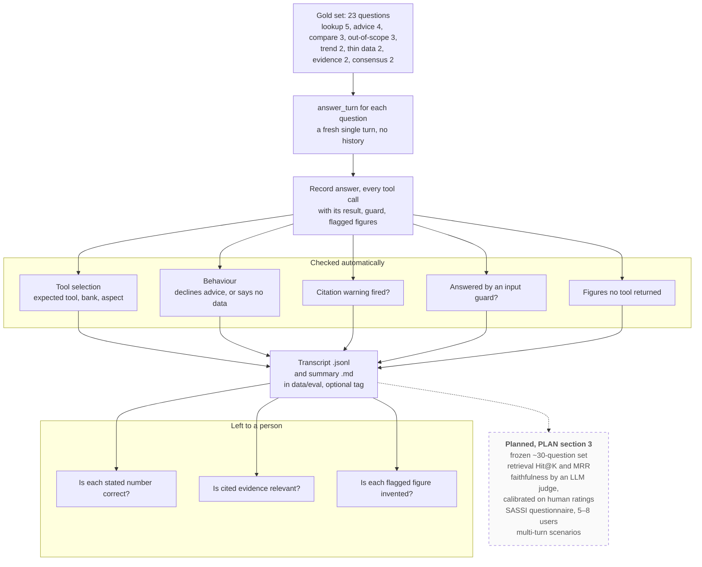

# How the chatbot is evaluated

What `chatbot/run_eval.py` does with the gold set, which checks it automates and which it leaves to a person, and what PLAN section 3 adds. For the report's evaluation section.

**Legend.** Solid shapes and arrows are built and running. Dashed shapes and arrows labelled *planned* are decided but not yet built, with the DESIGN.md decision that records them. Shapes marked *not installed* exist in the repository but aren't running anywhere.

Rendered for the report: [SVG](img/20-chatbot-evaluation.svg) · [PNG](img/20-chatbot-evaluation.png)

## What this shows and doesn't show

The automated checks are the ones a script can do reliably. Checking whether a number in
free text is the right number is not one of them, so the run keeps each tool call's raw
result in the transcript for a person to compare. The figure check is a strict detector,
not a grade: on the harness run, 18 of the 19 figures it flagged were invented and one was
a false alarm, which is why a person still reads them
(`docs/evidence/chatbot-harness-2026-09-26.md`). Every question is asked as a new
conversation, so this suite tests single turns only; memory was tested by hand, and
multi-turn scenarios are planned. The `--tag` option keeps one model's results from
overwriting another's, which is how backends and temperatures were compared.

## Sources

Each row names the file and line an element comes from, and the text that line must contain; `check_sources.py` verifies them.

| element | source | symbol checked |
|---|---|---|
| gold set | `chatbot/eval_gold_set.py:28` | `GOLD_SET = [` |
| fresh single turn | `chatbot/run_eval.py:171` | `turn = answer_turn(item["question"], backend_name=backend_name, verbose=False)` |
| record tool calls with results | `chatbot/run_eval.py:194` | `"result": c.get("result"), **({"by": c["by"]} if c.get("by") else {})}` |
| tool selection check | `chatbot/run_eval.py:74` | `def _check_tool_selection(item: dict, calls: list[dict])` |
| behaviour check | `chatbot/run_eval.py:96` | `def _check_behavior(item: dict, answer: str)` |
| advice decline | `chatbot/run_eval.py:100` | `if expected == "decline_advice":` |
| decline or no data | `chatbot/run_eval.py:104` | `if expected == "decline_or_no_data":` |
| citation flag | `chatbot/run_eval.py:182` | `fabricated = bool(turn.citation_unverified)` |
| input guard | `chatbot/run_eval.py:198` | `"input_guard": guard,` |
| unverified figures | `chatbot/run_eval.py:200` | `"unverified_numbers": numbers,` |
| output files and tag | `chatbot/run_eval.py:52` | `def _output_paths(tag: str | None)` |
| left to a person | `chatbot/run_eval.py:19` | `NOT automated, and left in the transcript for a human to grade` |
| figure check is not a grade | `chatbot/run_eval.py:16` | `check is a strict detector, not a grade` |
| 18 of 19 flagged were invented | `docs/evidence/chatbot-harness-2026-09-26.md:52` | `raw tool output, 18 were invented` |
| planned evaluation | `docs/PLAN.md:130` | `frozen ~30-question gold set; retrieval Hit@K and MRR; faithfulness via an LLM judge` |
| planned evaluation, recorded | `docs/DESIGN.md:387` | `set of about 30 questions written before tuning, retrieval Hit@K and MRR,` |

## Planned elements

| element | recorded in |
|---|---|
| Frozen set, Hit@K and MRR, LLM judge, SASSI, multi-turn scenarios | PLAN.md section 3, chatbot row; DESIGN.md decision 19 |
