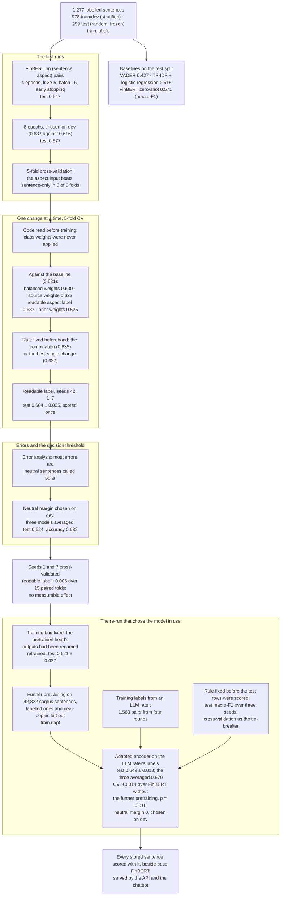

# How the sentiment model was trained and tuned

The sequence of experiments behind the fine-tuned FinBERT, from the first run to the model in use, with the score each step produced. For the report's solution-approach and results sections. Evidence: `finetune-2026-09-30`, `finetune-experiments-2026-09-30`, `finetune-fixes-2026-10-01`, `error-analysis-2026-10-01`, `noise-floor-cv-2026-10-02`, `retrain-2026-10-04`, `dapt-2026-10-06`, `model-rerun-2026-10-11`.

**Legend.** Solid shapes and arrows are built and running. Dashed shapes and arrows labelled *planned* are decided but not yet built, with the DESIGN.md decision that records them. Shapes marked *not installed* exist in the repository but aren't running anywhere.

Rendered for the report: [SVG](img/21-sentiment-model-development.svg) · [PNG](img/21-sentiment-model-development.png)

## What this shows and doesn't show

How the configuration was chosen, and what each step scored. The rule throughout: choose
on dev or cross-validation, and score the test split once per final configuration. The last
step chose between finished candidates by test macro-F1 over three seeds, under a rule
written down before any of them was scored, with cross-validation as the tie-breaker; by
every measure the adapted encoder trained on the LLM rater's labels led. Its lead over the
same fine-tuning without the further pretraining is small (0.649 against 0.631 on the 299
test rows, about one seed standard deviation); its lead over base FinBERT is about four
(0.649 against 0.571). The neutral margin chosen on dev for this model is 0, so the averaged
model is used as it is. Not shown: the padding check (no effect), per-class scores, the
per-seed epochs, and the runs with broker research rows added to people's labels; they are
in the evidence files.

## Sources

Each row names the file and line an element comes from, and the text that line must contain; `check_sources.py` verifies them.

| element | source | symbol checked |
|---|---|---|
| frozen test split | `train/labels.py:72` | `def check_splits(df: pd.DataFrame) -> None:` |
| sentence and aspect pairs | `train/finetune.py:242` | `enc = tokenizer(texts, aspect_inputs(df, aspect_text), truncation=True, max_length=128)` |
| early stopping | `train/finetune.py:351` | `callbacks=[EarlyStoppingCallback(early_stopping_patience=2)],` |
| chosen on dev macro-F1 | `train/finetune.py:336` | `metric_for_best_model="macro_f1",` |
| 5-fold cross-validation | `train/finetune.py:249` | `def fold_split(train_dev_df: pd.DataFrame, folds: int, fold: int, seed: int):` |
| class weights, now applied | `train/finetune.py:392` | `parser.add_argument("--class-weights", choices=["none", "balanced", "prior"], default="none")` |
| readable aspect label | `train/finetune.py:395` | `parser.add_argument("--aspect-text", choices=["key", "label"], default="key",` |
| zero-shot baseline | `train/evaluate.py:46` | `def eval_base_finbert_zeroshot(df: pd.DataFrame) -> dict:` |
| lexicon and TF-IDF baselines | `train/evaluate.py:70` | `def eval_tfidf_logreg(train_dev_df: pd.DataFrame, test_df: pd.DataFrame) -> dict:` |
| neutral margin | `train/error_analysis.py:59` | `def apply_margin(` |
| margin chosen on dev | `train/error_analysis.py:68` | `def best_margin(` |
| retrained after the head fix | `docs/evidence/retrain-2026-10-04.md:36` | `**0.621 ± 0.027**` |
| further pretraining | `train/dapt.py:221` | `def run(out_dir: str, epochs: float = 3` |
| the rule fixed before the run | `docs/evidence/model-rerun-2026-10-11.md:96` | `the rule fixed before the run (test macro-F1 over three seeds,` |
| cross-validation, +0.014 | `docs/evidence/model-rerun-2026-10-11.md:45` | `paired t = 2.75, p = 0.016` |
| test results of the model in use | `docs/model-card.md:53` | `| | **three seeds averaged** | **0.716** | **0.670** |` |
| margin 0, chosen on dev | `docs/evidence/model-rerun-2026-10-11.md:128` | `so the chosen margin is 0` |
| the model in use | `config/model_version.py:25` | `MODEL_VERSION = "finbert-adapted-finetuned-2026-10-11-3seed-m0"` |
| its margin | `config/model_version.py:40` | `"margin": 0.0,` |
