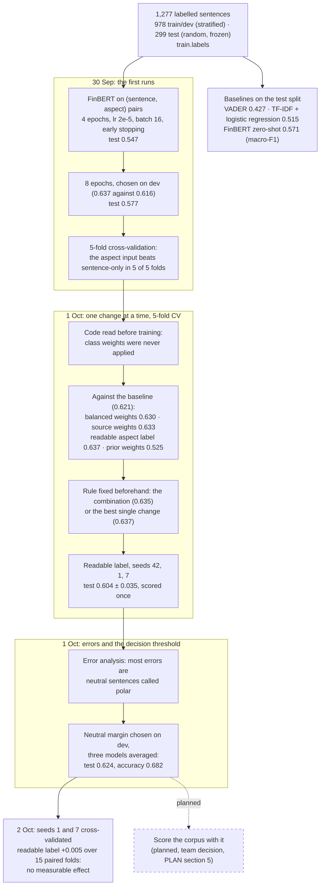

# How the sentiment model was trained and tuned

The sequence of experiments behind the fine-tuned FinBERT, from the first run to the check on two more seeds, with the score each step produced. For the report's solution-approach and results sections. Evidence: `finetune-2026-09-30`, `finetune-experiments-2026-09-30`, `finetune-fixes-2026-10-01`, `error-analysis-2026-10-01`, `noise-floor-cv-2026-10-02`.

**Legend.** Solid shapes and arrows are built and running. Dashed shapes and arrows labelled *planned* are decided but not yet built, with the DESIGN.md decision that records them. Shapes marked *not installed* exist in the repository but aren't running anywhere.

Rendered for the report: [SVG](img/21-sentiment-model-development.svg) · [PNG](img/21-sentiment-model-development.png)

## What this shows and doesn't show

How the configuration was chosen, and what each step scored. The rule throughout: choose on dev or cross-validation, score the test split once per final configuration. Not shown: the padding check (no effect), per-class scores, and the per-seed epochs; they are in the evidence files.

## Sources

Each row names the file and line an element comes from, and the text that line must contain; `check_sources.py` verifies them.

| element | source | symbol checked |
|---|---|---|
| frozen test split | `train/labels.py:72` | `def check_splits(df: pd.DataFrame) -> None:` |
| sentence and aspect pairs | `train/finetune.py:225` | `enc = tokenizer(texts, aspect_inputs(df, aspect_text), truncation=True, max_length=128)` |
| early stopping | `train/finetune.py:331` | `callbacks=[EarlyStoppingCallback(early_stopping_patience=2)],` |
| chosen on dev macro-F1 | `train/finetune.py:316` | `metric_for_best_model="macro_f1",` |
| 5-fold cross-validation | `train/finetune.py:232` | `def fold_split(train_dev_df: pd.DataFrame, folds: int, fold: int, seed: int):` |
| class weights, now applied | `train/finetune.py:372` | `parser.add_argument("--class-weights", choices=["none", "balanced", "prior"], default="none")` |
| readable aspect label | `train/finetune.py:375` | `parser.add_argument("--aspect-text", choices=["key", "label"], default="key",` |
| zero-shot baseline | `train/evaluate.py:47` | `def eval_base_finbert_zeroshot(df: pd.DataFrame) -> dict:` |
| lexicon and TF-IDF baselines | `train/evaluate.py:71` | `def eval_tfidf_logreg(train_dev_df: pd.DataFrame, test_df: pd.DataFrame) -> dict:` |
| neutral margin | `train/error_analysis.py:58` | `def apply_margin(` |
| margin chosen on dev | `train/error_analysis.py:67` | `def best_margin(` |
