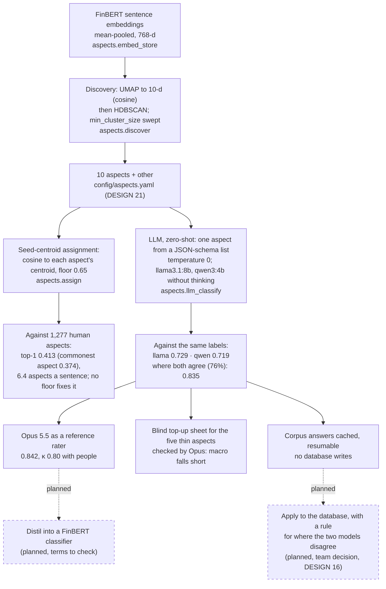

# How the aspect method was chosen

From discovering the aspects to classifying sentences into them: what was tried, how each was measured against the human aspect labels, and what waits for the team. For the report's solution-approach section. Evidence: `aspect-taxonomy-2026-09-25`, `aspect-discovery-sweep-2026-09-30`, `aspect-assignment-calibration-2026-09-30`, `llm-aspect-classifier-2026-10-01`, `opus-labeller-2026-10-01`, `labelling-topup-2026-10-01`.

**Legend.** Solid shapes and arrows are built and running. Dashed shapes and arrows labelled *planned* are decided but not yet built, with the DESIGN.md decision that records them. Shapes marked *not installed* exist in the repository but aren't running anywhere.

Rendered for the report: [SVG](img/22-aspect-method-development.svg) · [PNG](img/22-aspect-method-development.png)

## What this shows and doesn't show

Why the pipeline's aspect method should change, and how each option was measured. Not shown: the per-aspect scores and confusions, the 338 discovery clusters, or the prompt text; they are in the evidence files and `aspects/llm_classify.py`.

## Sources

Each row names the file and line an element comes from, and the text that line must contain; `check_sources.py` verifies them.

| element | source | symbol checked |
|---|---|---|
| UMAP reduction | `aspects/discover.py:90` | `reducer = umap.UMAP(n_neighbors=15, min_dist=0.0, n_components=10, metric="cosine",` |
| HDBSCAN clustering | `aspects/discover.py:95` | `clusterer = hdbscan.HDBSCAN(min_cluster_size=min_cluster_size, metric="euclidean")` |
| similarity floor | `config/aspects.yaml:224` | `similarity_floor: 0.65` |
| calibration against human aspects | `aspects/assignment_eval.py:52` | `def label_metrics(sims: np.ndarray, aspects: list[str], human: list[str], floor: float) -> dict:` |
| one aspect from a fixed list | `aspects/llm_classify.py:97` | `"format": {"type": "object", "properties": {"aspect": {"type": "string", "enum": keys}},` |
| temperature 0 | `aspects/llm_classify.py:99` | `"options": {"temperature": 0},` |
| corpus cache | `aspects/llm_classify.py:160` | `def corpus_rows(conn, seed: int = 2026, limit: int | None = None) -> pd.DataFrame:` |
| Opus rounds | `train/opus_labels.py:269` | `def extra_batches(name: str) -> list[str]:` |
| top-up sheet | `preprocess/export_topup.py:97` | `def select(pool: pd.DataFrame, llm_aspect: pd.Series, targets: dict[str, int]) -> pd.DataFrame:` |
