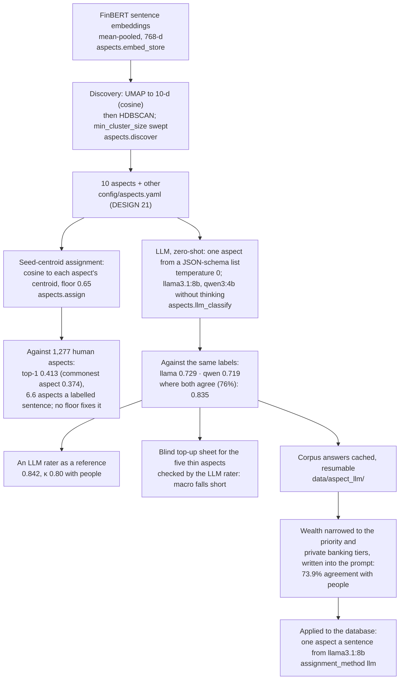

# How the aspect method was chosen

From discovering the aspects to classifying sentences into them: what was tried, how each was measured against the human aspect labels, and what was applied. For the report's solution-approach section. Evidence: `aspect-taxonomy-2026-09-25`, `aspect-discovery-sweep-2026-09-30`, `aspect-assignment-calibration-2026-09-30`, `llm-aspect-classifier-2026-10-01`, `llm-rater-2026-10-01`, `labelling-topup-2026-10-01`, `wealth-definition-trial-2026-10-12`, `rescore-wealth-wording-2026-10-14`.

**Legend.** Solid shapes and arrows are built and running. Dashed shapes and arrows labelled *planned* are decided but not yet built, with the DESIGN.md decision that records them. Shapes marked *not installed* exist in the repository but aren't running anywhere.

Rendered for the report: [SVG](img/22-aspect-method-development.svg) · [PNG](img/22-aspect-method-development.png)

## What this shows and doesn't show

Why the pipeline's aspect method changed, and how each option was measured. The answers
applied come from `llama3.1:8b` alone: where it and `qwen3:4b` agree the answers are more
accurate (0.835), but no rule combining the two was applied. The wealth aspect was narrowed
to the priority and private banking tiers and the wording written into the prompt; under
it 6,914 of the 45,844 sentences (15%) changed aspect. Centroid assignment is kept only for
the comparison. A FinBERT classifier distilled from the LLM's answers was considered and
not built. Not shown: the per-aspect scores and confusions, the 338 discovery clusters, or
the prompt text; they are in the evidence files and `aspects/llm_classify.py`.

## Sources

Each row names the file and line an element comes from, and the text that line must contain; `check_sources.py` verifies them.

| element | source | symbol checked |
|---|---|---|
| UMAP reduction | `aspects/discover.py:90` | `reducer = umap.UMAP(n_neighbors=15, min_dist=0.0, n_components=10, metric="cosine",` |
| HDBSCAN clustering | `aspects/discover.py:95` | `clusterer = hdbscan.HDBSCAN(min_cluster_size=min_cluster_size, metric="euclidean")` |
| similarity floor | `config/aspects.yaml:228` | `similarity_floor: 0.65` |
| calibration against human aspects | `aspects/assignment_eval.py:52` | `def label_metrics(sims: np.ndarray, aspects: list[str], human: list[str], floor: float) -> dict:` |
| one aspect from a fixed list | `aspects/llm_classify.py:98` | `"format": {"type": "object", "properties": {"aspect": {"type": "string", "enum": keys}},` |
| temperature 0 | `aspects/llm_classify.py:100` | `"options": {"temperature": 0},` |
| corpus cache | `aspects/llm_classify.py:161` | `def corpus_rows(conn, seed: int = 2026, limit: int | None = None) -> pd.DataFrame:` |
| Opus rounds | `train/rater_labels.py:273` | `def extra_batches(name: str) -> list[str]:` |
| top-up sheet | `preprocess/export_topup.py:97` | `def select(pool: pd.DataFrame, llm_aspect: pd.Series, targets: dict[str, int]) -> pd.DataFrame:` |
| 73.9% with the narrower wealth wording | `docs/evidence/wealth-definition-trial-2026-10-12.md:53` | `| People, older reading | 1,277 | 72.9% | 73.9% |` |
| 15% of sentences changed aspect | `docs/evidence/rescore-wealth-wording-2026-10-14.md:10` | `6,914 of the 45,844 sentences (15%) changed aspect` |
| applied: the LLM assigns aspects | `config/aspects.yaml:236` | `assignment_method: llm` |
| the LLM | `config/aspects.yaml:244` | `llm_model: "llama3.1:8b"` |
| LLM answers stored | `aspects/assign.py:111` | `rows = _assign_llm(conn, [sentence_ids[i] for i in todo_idx])` |
