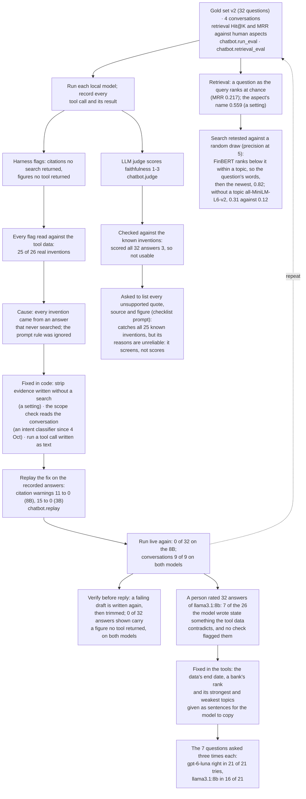

# How the chatbot was evaluated and improved

The loop that found the chatbot's failures and fixed them: run a frozen question set, read every automated flag by hand, find the cause, fix it in code, check the fix on the recorded answers, then run live again. The judge branch shows why an evaluator needs checking too. For the report's evaluation section. Evidence: `chatbot-eval-build-2026-10-01` (Live runs), `human-ratings-2026-10-24`, `chatbot-fixes-2026-10-24`, `search-models-2026-10-24`.

**Legend.** Solid shapes and arrows are built and running. Dashed shapes and arrows labelled *planned* are decided but not yet built, with the DESIGN.md decision that records them. Shapes marked *not installed* exist in the repository but aren't running anywhere.

Rendered for the report: [SVG](img/23-chatbot-improvement-loop.svg) · [PNG](img/23-chatbot-improvement-loop.png)

## What this shows and doesn't show

The order of work, and the principle that every automated check, including the judge,
was checked by hand before it was trusted. The rating round shows why: the answers it
found unfaithful carried only figures a tool had returned, so no automated check could
flag them; the fix put the wording the model kept getting wrong (the data's end date, a
bank's rank, its strongest and weakest topics) into the tools' results. The search was
tested the same way, against a random draw from the same pool: within a topic FinBERT's
ranking scored 0.66 against the random draw's 0.74, so the question's words, then the
newest, are used there (0.82), and `all-MiniLM-L6-v2` vectors without a topic (0.31 against
FinBERT's 0.12). Not shown: the user questionnaire (SASSI), still to do if time allows.

## Sources

Each row names the file and line an element comes from, and the text that line must contain; `check_sources.py` verifies them.

| element | source | symbol checked |
|---|---|---|
| gold set v2 | `chatbot/eval_gold_set.py:121` | `GOLD_SET_V2 = ` |
| conversations | `chatbot/run_eval.py:383` | `def run_multi_turn(` |
| random baseline for retrieval | `chatbot/retrieval_eval.py:57` | `def random_baseline(` |
| citation flag | `chatbot/agent.py:941` | `def answer_has_unverified_citation(self, answer: str) -> bool:` |
| strip evidence written without a search | `chatbot/agent.py:2008` | `def strip_unsearched_evidence(answer: str) -> str:` |
| scope check reads the conversation | `chatbot/intent.py:60` | `def describe_context(state` |
| tool call written as text | `chatbot/backends/_text_tool_call.py:61` | `def text_tool_call(content: str, tool_names: set[str])` |
| replay on recorded answers | `chatbot/replay.py:28` | `def replay(results: list[dict], mode: str) -> list[dict]:` |
| judge checked against the flags | `chatbot/judge.py:203` | `def against_checks(results: list[dict], judged: pd.DataFrame) -> pd.DataFrame:` |
| checklist judge | `chatbot/judge.py:134` | `def checklist_score(parsed: dict) -> tuple[int, str]:` |
| verify before reply | `config/chatbot.yaml:59` | `verify_before_reply: {value: true, env: CHATBOT_VERIFY_BEFORE_REPLY}` |
| 0 of 32 shown, both models | `docs/evidence/chatbot-fixes-2026-10-24.md:35` | `| The same, in the answer shown | 0 / 32 | 0 / 32 | 0 / 32 |` |
| a person's ratings | `docs/evidence/human-ratings-2026-10-24.md:11` | `7 of the 26 answers the model wrote (27%) state something the` |
| fixed in the tools | `docs/evidence/chatbot-fixes-2026-10-24.md:7` | `The fixes: the tools now give the data's end date, a bank's rank, a` |
| retest, 21 of 21 and 16 of 21 | `docs/evidence/chatbot-fixes-2026-10-24.md:17` | `` was right in 16 of 21 tries and `gpt-6-luna` in 21 of 21 `` |
| search: words, then newest, 0.82 | `docs/evidence/search-models-2026-10-24.md:41` | `| Question's words, then newest (in use within a topic) | 0.818 | 0.207 |` |
| search: FinBERT within a topic | `docs/evidence/search-models-2026-10-24.md:42` | `| FinBERT similarity | 0.661 | 0.129 |` |
| search: MiniLM without a topic | `docs/evidence/search-models-2026-10-24.md:45` | `| all-MiniLM-L6-v2 + word bonus | 0.754 | 0.314 |` |
| words, then newest, in use | `config/chatbot.yaml:84` | `within_topic:     {value: "words_then_newest"}` |
