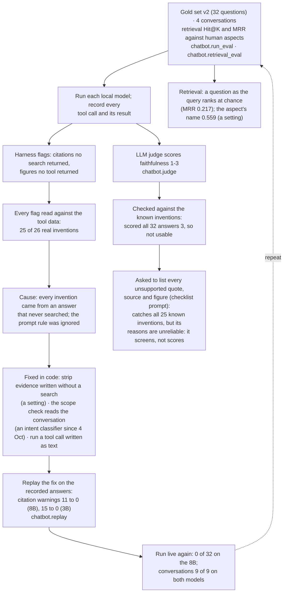

# How the chatbot was evaluated and improved

The loop that found the chatbot's failures and fixed them: run a frozen question set, read every automated flag by hand, find the cause, fix it in code, check the fix on the recorded answers, then run live again. The judge branch shows why an evaluator needs checking too. For the report's evaluation section. Evidence: `chatbot-eval-build-2026-10-01` (Live runs).

**Legend.** Solid shapes and arrows are built and running. Dashed shapes and arrows labelled *planned* are decided but not yet built, with the DESIGN.md decision that records them. Shapes marked *not installed* exist in the repository but aren't running anywhere.

Rendered for the report: [SVG](img/23-chatbot-improvement-loop.svg) · [PNG](img/23-chatbot-improvement-loop.png)

## What this shows and doesn't show

The order of work, and the principle that every automated check, including the judge, was checked by hand before it was trusted. Not shown: the human ratings and the user questionnaire, which are still to do (PLAN section 3).

## Sources

Each row names the file and line an element comes from, and the text that line must contain; `check_sources.py` verifies them.

| element | source | symbol checked |
|---|---|---|
| gold set v2 | `chatbot/eval_gold_set.py:121` | `GOLD_SET_V2 = ` |
| conversations | `chatbot/run_eval.py:267` | `def run_multi_turn(` |
| random baseline for retrieval | `chatbot/retrieval_eval.py:53` | `def random_baseline(` |
| citation flag | `chatbot/agent.py:669` | `def answer_has_unverified_citation(self, answer: str) -> bool:` |
| strip evidence written without a search | `chatbot/agent.py:837` | `def strip_unsearched_evidence(answer: str) -> str:` |
| scope check reads the conversation | `chatbot/intent.py:59` | `def describe_context(state` |
| tool call written as text | `chatbot/backends/_text_tool_call.py:19` | `def text_tool_call(content: str, tool_names: set[str])` |
| replay on recorded answers | `chatbot/replay.py:28` | `def replay(results: list[dict], mode: str) -> list[dict]:` |
| judge checked against the flags | `chatbot/judge.py:203` | `def against_checks(results: list[dict], judged: pd.DataFrame) -> pd.DataFrame:` |
| checklist judge | `chatbot/judge.py:134` | `def checklist_score(parsed: dict) -> tuple[int, str]:` |
