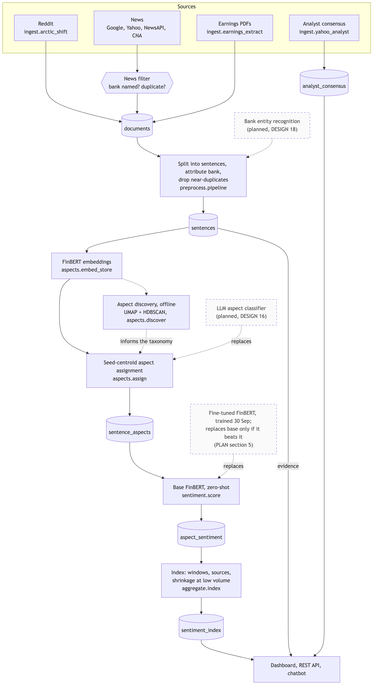
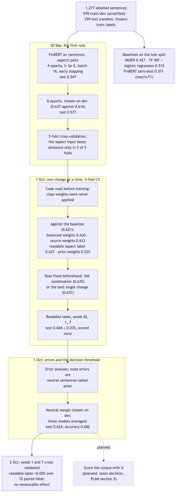
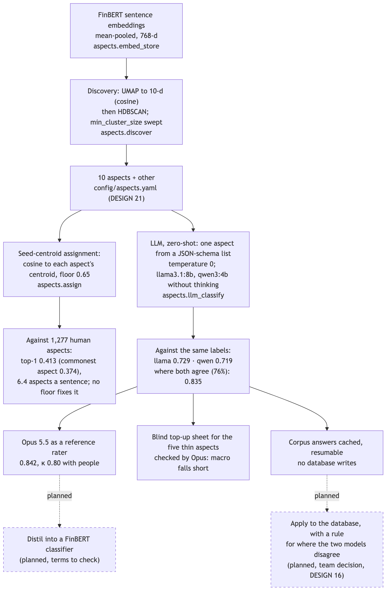
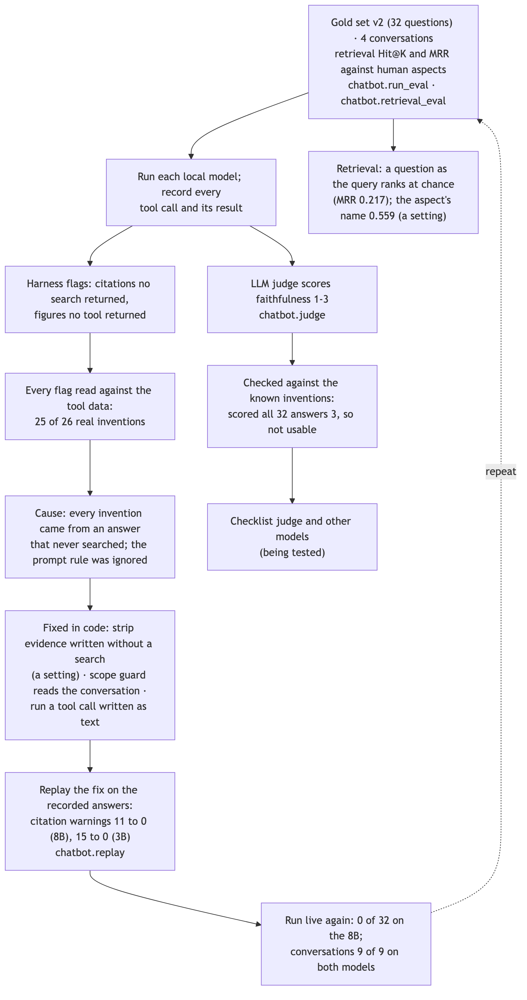

# The approach: how the system was built, trained, tuned and evaluated

*For the report's solution-approach section, the presentation, and anyone
learning from the project. Each part says what was done and with what
settings, explains the technique in a short teaching note, and links the
evidence. The last part evaluates the approach as a whole. Written
2 October 2026; figures are from the evidence files, as of the 30 September
database snapshot.*

**Diagrams used here** (all in [docs/diagrams/](../diagrams/README.md), with
PNG and SVG renders for the report): the processing pipeline (04), labelling
and training (09), how an index row is computed (12), how the chatbot is
evaluated (20), and three made for this document: sentiment model
development (21), aspect method development (22) and the chatbot's
evaluate-and-fix loop (23).

---

## 1. The frame

The project follows CRISP-DM (Text Analytics, Day 1): understand the business
question, understand and prepare the data, model, evaluate, deploy. The
business question is what retail investors and the public say about DBS,
OCBC and UOB, broken down by financial aspect, with the evidence behind each
number.

**The unit of analysis is the sentence.** Every source (Reddit, earnings
reports, news) is split into sentences; each sentence is attributed to a
bank, given an aspect and a sentiment, and those are aggregated into an
index. The chatbot answers questions from the same store.

> **Teaching note: why sentences, not documents.** A news article or a Reddit
> thread mentions several banks and topics, often with different sentiment
> ("margins held up but provisions rose"). Scoring the whole document blurs
> them. Scoring sentences keeps each claim attached to one bank and one
> aspect, and gives the chatbot a quotable unit of evidence. The cost: a
> sentence can lose context ("it fell again" without saying what).

**Four text-mining tasks** sit on that pipeline: aspect discovery
(clustering), aspect categorisation, bank entity recognition, and sentiment
classification, which is the deep neural network the rubric requires.

---

## 2. Data and labels

**Collection.** Reddit through the Arctic Shift archive, the banks' earnings
PDFs (UOB's through the Wayback Machine), Google News and Yahoo Finance
headlines, CNA articles and NewsAPI; analyst consensus from Yahoo. 44,345
sentences after cleaning, de-duplication and a relevance filter for news
(`ingest/`, `preprocess/`).

**Labelling** ([diagram 09](../diagrams/09-labelling-training.md)). Two
people labelled 1,300 sentences for aspect and sentiment; 1,277 remain after
removing duplicates and sentences on both sides of the split. The split:
978 train/dev, drawn stratified to over-sample the rarer aspects and
polarities; 299 test, drawn at random and frozen, labelled on a blind sheet.

> **Teaching note: a frozen random test split.** Selection (which
> configuration, which threshold) must never see the test split, or the test
> score measures how well you tuned to it. Stratifying train/dev gives the
> model enough rare cases to learn from; keeping the test split random keeps
> its score an estimate for the corpus as it is. `train.labels` refuses a file
> where a sentence sits in both splits, because a duplicate there leaks the
> answer.

> **Teaching note: agreement before accuracy.** Cohen's κ measures how far
> two people agree beyond chance. A model can't be judged against labels
> people don't agree on. Sentiment κ was 0.93; aspect agreement between two
> people hasn't been measured yet, which is a gap (section 8).

**An LLM as an extra rater.** Opus 5.5 labelled the same sentences blind, as
Claude Code subagents given the annotation guideline and nothing else; their
transcripts were audited to confirm they opened no other file. Aspect κ 0.80
and sentiment κ 0.79 against the people. These labels never replace a human
label: they show where the guideline is ambiguous (the neutral boundary;
wealth against retail banking).

---

## 3. The sentiment model: fine-tuning FinBERT

**The model.** `ProsusAI/finbert`, a BERT model further pre-trained on
financial text, fine-tuned to classify a (sentence, aspect) pair as
negative, neutral or positive (`train/finetune.py`).

| setting | value |
|---|---|
| input | `[CLS] sentence [SEP] aspect [SEP]`, at most 128 tokens, padded per batch |
| optimiser | AdamW, learning rate 2e-5, batch 16 |
| schedule | linear warm-up over 10% of steps, then linear decay |
| training length | up to 8 epochs; early stopping, patience 2 on dev macro-F1; the best epoch kept |
| loss | plain cross-entropy (class and source weights tested, not kept) |
| seeds | 42, 1, 7 |
| hardware | MacBook Air M1, 16 GB, Apple GPU (MPS); about 5–15 minutes a model |

> **Teaching note: transfer learning.** Training a language model from
> scratch needs far more text than 978 labelled sentences. Fine-tuning starts
> from a model that already represents language (BERT), and here financial
> language (FinBERT), and adjusts it to the task with a small learning rate,
> so the labelled data only has to teach the task, not English. The same
> FinBERT used zero-shot (its own three-way sentiment head, no fine-tuning)
> is the strongest baseline.

> **Teaching note: the aspect as a second sentence.** Aspect-based sentiment
> asks "how does this sentence feel about *this aspect*?". Feeding the aspect
> as BERT's second segment lets attention relate the two, so the same
> sentence can be positive on margins and negative on asset quality. Cross-
> validation confirmed the input helps (it won in 5 of 5 folds against the
> sentence alone).

> **Teaching note: macro-F1, not accuracy.** The corpus is about 70%
> neutral (by zero-shot FinBERT's labels). A model that calls everything neutral scores 70% accuracy and is
> useless for an index of sentiment. Macro-F1 averages the F1 of each class,
> so negative and positive count as much as neutral.

**How the configuration was chosen.** One question at a time, on dev scores
or cross-validation, never on the test split:

1. Training length: 8 epochs beat 4 on dev (0.637 against 0.616).
2. The aspect input: kept (5-fold cross-validation).
3. One change at a time against a baseline, each cross-validated on 5 folds:
   balanced class weights, prior class weights, source weights, and writing
   the aspect as a readable label ("Dividend Policy" rather than
   `dividend_policy`). The rule for combining them was written down before the
   combined run.
4. Three seeds of the chosen configuration, scored once on test.

> **Teaching note: k-fold cross-validation and the noise floor.** With 978
> rows, one 15% dev split holds about 147 sentences; one sentence moves its
> macro-F1 noticeably. Five folds use every row for validation once and
> average out some of that. But a difference between two configurations still
> has to beat the noise: two runs of the *same* configuration differed fold by
> fold with a standard deviation of 0.024, so a gain of 0.016 on one seed is
> not evidence. Repeating on
> more seeds settles it: on seeds 1 and 7 the readable label's lead vanished
> (+0.005 over 15 paired folds).

> **Teaching note: class weights, and why CV couldn't judge them.**
> Weighting the loss by inverse class frequency ("balanced") makes rare
> classes count more. "Prior" weights aim the model at the corpus's class
> mix (70% neutral) instead of the training mix (38%). Cross-validation's dev
> folds come from the training mix, so they punish exactly the shift prior
> weights are for. Judging them needs a dev set sampled like the corpus.

**After the choice: errors and the threshold**
([error-analysis](../evidence/error-analysis-2026-10-01.md)). Most errors are
neutral sentences called positive or negative, typically Reddit descriptions
of retail products. A neutral margin, chosen on dev, calls a sentence neutral
unless the top polar class beats neutral by that margin. Averaging the three
seeds' probabilities and applying the margin gives the best test result:

| model | macro-F1 | accuracy |
|---|---|---|
| VADER lexicon | 0.427 | 0.49 |
| TF-IDF + logistic regression | 0.515 | 0.57 |
| FinBERT zero-shot | 0.571 | 0.70 |
| fine-tuned, three seeds | 0.604 ± 0.035 | 0.61–0.68 |
| three seeds averaged, neutral margin | **0.624** | 0.682 |

> **Teaching note: tuning the decision, not the model.** A classifier outputs
> probabilities; the decision rule (argmax) is a separate choice. Moving the
> boundary trades one error for another: here 13 fewer neutral-called-polar
> errors for 7 more polar-called-neutral. Choosing it on dev keeps the test
> split clean. Averaging several seeds (a small ensemble) reduces the
> variance that one seed's luck adds.

---

## 4. Aspects: discovery, then classification

**Discovery.** FinBERT sentence embeddings (mean-pooled), reduced with UMAP
to 10 dimensions (cosine, 15 neighbours) and clustered with HDBSCAN. The
clusters were read and labelled into ten aspects plus `other`
(`config/aspects.yaml`, DESIGN decision 21).

> **Teaching note: UMAP + HDBSCAN.** Clustering 768-dimensional vectors
> directly works poorly (distances concentrate in high dimensions). UMAP
> projects them to a few dimensions that keep local neighbourhoods; HDBSCAN
> then finds dense groups without being told how many, and leaves sparse
> points as noise. The main setting, `min_cluster_size`, changes the result
> sharply: 358 clusters at 10 (65% noise), one giant cluster at 25 and 50, 25
> aspect-like clusters at 100.

**Assignment, first attempt: seed centroids.** Each aspect's centroid is the
mean embedding of its seed terms in `config/aspects.yaml`; a sentence gets every aspect whose
centroid it is closer to than a similarity floor (0.65). Measured against the
1,277 human aspects: the top match is the human's aspect 41% of the time,
barely above always guessing the commonest (37%), and a sentence gets 6.4
aspects on average. No floor fixes it.

> **Teaching note: why the embeddings failed.** FinBERT's mean-pooled
> vectors were never trained to place similar meanings close together; they
> encode style and register strongly. Earnings prose sits near earnings
> prose and Reddit questions near Reddit questions, whatever the topic. The
> same weakness makes the chatbot's evidence search rank at chance for
> question-phrased queries (section 7). Sentence-similarity models
> (Sentence-BERT) are trained for exactly what was needed.

**Assignment, second attempt: an LLM classifier** (`aspects/llm_classify.py`).
A local model reads the sentence and the aspect definitions and returns one
aspect, constrained by a JSON schema whose only allowed values are the
eleven aspect keys; temperature 0; `qwen3:4b` with its thinking turned off.
Against the same labels: `llama3.1:8b` 0.729, `qwen3:4b` 0.719; where the
two agree (76% of sentences), 0.835. Opus 5.5 scores 0.842, a ceiling for
what a careful reader with the guideline achieves.

> **Teaching note: zero-shot classification with structured output.** An
> instruction-tuned LLM can classify without training examples if told the
> categories and their definitions. Constraining the output to a JSON schema
> with an enumerated field removes parsing errors and invalid answers; zero
> temperature makes it deterministic. Agreement between two different models
> is a cheap confidence signal, since an LLM gives one answer and no
> probability.

The corpus run takes about 24 hours on the MacBook, so the answers are
cached in a fixed random order and the run resumes; nothing is written to
the database until the team decides.

---

## 5. Bank attribution: entity recognition

Alias matching (does the text contain "DBS"?) counts "UOB Kay Hian" as UOB
and "DBS Vickers" as DBS. The NER step (`preprocess/bank_ner.py`) uses spaCy
with an entity ruler placed before the statistical model, a resolution table
mapping each recognised name to a bank or to "not the bank", and a gazetteer
fallback for names the tokenizer glues to punctuation or numbers ("OCBC360").
It changes the attribution of 763 sentences (1.7%).

> **Teaching note: recognition and resolution are different decisions.**
> Recognition finds the span ("DBS Vickers") and its type; resolution decides
> which real entity it refers to (DBS, or a broker that isn't the bank). The
> ruler injects domain knowledge without retraining; the resolution table
> keeps the policy in one editable place, so changing the DBS Vickers rule
> is one line.

---

## 6. The index

Each sentence's label counts +1, 0 or −1, weighted by the model's confidence
and the source's weight, averaged per bank, aspect and window, and shrunk
towards zero when there are few sentences: score × n / (n + 5)
([diagram 12](../diagrams/12-index-computation.md)). The headline counts
each sentence once, by its most confident aspect.

> **Teaching note: shrinkage.** An average over 3 sentences is noisy; one
> angry post swings it. Multiplying by n / (n + K) pulls small samples
> towards zero (no evidence) and leaves large ones almost untouched: with
> K = 5, 5 sentences keep half their score, 100 keep 95%.

---

## 7. The chatbot

A tool-calling agent over the same store: tools for sentiment, comparison,
trend, coverage, evidence search and analyst consensus; a local model through
Ollama by default. Around the model sits a harness: input guards answer
advice and off-topic questions without the model; output checks flag
citations no search returned and figures no tool returned.

**How it was evaluated and improved** ([diagram 20](../diagrams/20-chatbot-evaluation.md),
[evidence](../evidence/chatbot-eval-build-2026-10-01.md)). A frozen gold set
(32 questions, v1's 23 kept so results stay comparable), four multi-turn
conversations, and retrieval metrics against the human aspect labels with an
exact random baseline. Every automated flag was read by hand against the tool
data, which found the cause of the main failure: every invented citation came
from an answer that never searched for evidence. The fixes went into code,
were tested by replaying the recorded answers, then run live.

> **Teaching note: RAG and why retrieval quality decides grounding.**
> Retrieval-augmented generation answers from retrieved text rather than the
> model's memory, and cites it. If retrieval returns off-topic text, the
> answer can quote it faithfully and still be wrong: the citation check
> confirms a quote was retrieved, not that it is relevant. Measuring retrieval
> separately (Hit@K, MRR against a random baseline) showed question-phrased
> queries rank at chance.

> **Teaching note: enforce in code what the system can check.** A prompt
> rule ("don't write an evidence section unless you searched") is a request;
> small models ignore it under a competing format rule. The harness knows
> whether a search happened, so it can remove such a section itself.

> **Teaching note: evaluate the evaluator.** An LLM judge was meant to score
> faithfulness at scale, calibrated on human ratings. Checked first against
> answers already known to contain invented evidence, it passed all of them.
> A judge that never disagrees has nothing to calibrate; checking it cost
> minutes and saved hours of rating.

> **Teaching note: replay to isolate a change.** The model samples at
> temperature 0.2, so a fresh run changes its answers as well as the fix.
> Applying a post-processing fix to recorded answers compares like with like.

---

## 8. Evaluating the approach

Judged against five criteria: whether the measurements are valid, whether
the methods fit the data and the hardware, whether results reproduce, whether
measured improvements reach the product, and what it cost.

| part | strengths | weaknesses | verdict |
|---|---|---|---|
| labels | frozen random test split; leakage removed in code; human κ 0.93; an audited LLM rater shows where the guideline is loose | test labels anchored on a model's suggestion (89% match); no human aspect agreement; 39 negative test rows | **adequate**: comparisons between models hold, absolute scores less so |
| sentiment model | sound procedure: dev-only selection, rules fixed in advance, three seeds, three baselines, error analysis, a dev-chosen threshold | selection on one seed was inside the noise; the gain over zero-shot is about one seed sd; worse accuracy | **sound method, modest result**, honestly reported |
| aspect discovery | standard, appropriate unsupervised method; parameter sensitivity measured | taxonomy labels drafted with an AI assistant, checked by no second person; FinBERT embeddings encode register | **adequate as exploration** |
| aspect classification | measured against human labels; centroid failure diagnosed, not tuned around; LLM classifier far better, with a confidence signal | not yet applied; weak on loose boundaries and local products; 24 h of compute | **right method, not yet deployed** |
| entity recognition | transparent rules plus a model; a reference check found and fixed a bug | no human gold labels yet; one contestable policy (DBS Vickers) | **promising, unproven** |
| index | confidence and source weighting, shrinkage, one vote per sentence, a continuous series with the same weights | the source mix drives the headline; per-aspect rows inherit the weak aspect method | **well designed, weak inputs** |
| chatbot | a harness with guards and checks; a frozen gold set; retrieval measured against chance; every flag read by hand; fixes replayed then run live; the judge checked before use | retrieval rests on embeddings that rank questions at chance; no human ratings or user study yet; one run per configuration | **strong evaluation, weak retrieval** |

**What the approach did well.** Its evaluation discipline: every number
traces to a command; the test split was never used to choose; negative
results (centroid assignment, question retrieval, a judge that never
disagrees, a selection that didn't replicate) were reported with their
cause. It fits the constraints: a few thousand labels and a 16 GB laptop made
transfer learning, zero-shot LLMs and small local models the sensible
choices over training anything large.

**Where it fell short.**
1. **Measured but not deployed.** On all four components the database still
   uses the method the project measured as weaker. The approach optimised the
   evidence before the product; with a month left the order should reverse.
2. **One embedding model for three jobs.** FinBERT's mean-pooled vectors were
   used for discovery, aspect assignment and retrieval; they suit none of the
   similarity tasks. One sentence-similarity model would likely have fixed two
   of the three.
3. **Labels before agreement.** Labelling proceeded without measuring aspect
   agreement and with a model's suggestion in view, which limits what every
   later measurement can claim.
4. **Seeds counted late.** Three seeds were used for testing from the start,
   but model selection used one seed until the check on 2 October.

**What a second attempt would change** (alternatives not tried here):
- **Retrieval and aspect similarity:** a sentence-similarity encoder
  (Sentence-BERT family), plus a cross-encoder to re-rank the top evidence.
- **Aspects:** distil the LLM's or Opus's labels into a fine-tuned
  classifier, after checking the provider's terms, so the corpus runs in
  minutes instead of a day; or train one model that predicts aspect and
  sentiment together.
- **Labels:** a blind agreement round on aspects first, then active learning
  (label what the model is least sure of) instead of stratified sampling.
- **The sentiment model:** domain-adaptive pre-training on the corpus itself
  (Singapore banking Reddit and reports), since local product vocabulary is
  where models go wrong; probability calibration (temperature scaling)
  alongside the neutral margin.
- **Selection:** three seeds × five folds as the standard from the first
  experiment, with a paired test on the fold differences.

**Overall.** For a small team on a laptop, the approach chose appropriate
methods and evaluated them unusually carefully; its results are modest where
the data is small and anchored, and strong where it diagnosed failure
(centroids, retrieval, the judge, invented evidence) and fixed it in code.
Its remaining weakness is the gap between what it has measured and what it
runs.

---

## Sources

Evidence files in [docs/evidence/](../evidence/): finetune-2026-09-30,
finetune-experiments-2026-09-30, finetune-fixes-2026-10-01,
error-analysis-2026-10-01, noise-floor-cv-2026-10-02,
aspect-taxonomy-2026-09-25, aspect-discovery-sweep-2026-09-30,
aspect-assignment-calibration-2026-09-30, llm-aspect-classifier-2026-10-01,
opus-labeller-2026-10-01, bank-ner-2026-10-01, index-preview-2026-10-01,
chatbot-eval-build-2026-10-01, labelling-topup-2026-10-01. Design decisions:
[DESIGN.md](../DESIGN.md). The learning folder ([learning/](../../learning/README.md))
has a longer note on each technique, with exercises.
